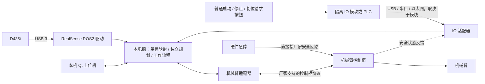

# 实机接入：D435i、多型号机械臂与按钮 IO

本电脑暂代工控机。当前已提供实机只读接入层，尚未进行真实机械臂运动联调。2026-09-21 USB 检查未发现 D435i，首台控制柜协议、IP、相机安装位置和 IO 模块仍待确认。

## 物理连接与软件边界



普通按钮向流程发出请求，是否执行还要检查设备、标定、轨迹及控制器状态。急停直接进入控制柜规定的安全回路；普通 PC IO、Qt 按钮或 ROS 消息不能代替这一回路。电脑一般没有可直接接工业 24 V 按钮的通用 IO，需要选定模块后实现对应驱动。

图中“电脑网口 → 电箱”需要区分普通 TCP/IP 控制接口与 EtherCAT 主站。本地华沿仓库 humble_ethercat 分支实现的是 EtherCAT，文档要求厂家驱动参数与 PREEMPT_RT；不能把控制柜 IP 写入网卡名称配置。若要保留厂家控制柜控制功能，须确认厂家提供的控制柜 SDK / 网络协议或官方驱动。这里没有猜测端口、扫描网络或连接控制柜。

## 已完成的可运行内容

- `massage_hardware` 独立 ROS2 包：D435i 启动、只读 Qt 接入窗口、USB 设备盘点。
- D435i 采用彩色图像、对齐到彩色的深度与彩色内参。配置 640×480 @ 30 fps，关闭当前未使用的 IMU 和点云。
- 统一配置机械臂关节顺序、关节反馈话题、轨迹 action 名称、基座 / 法兰 / TCP 坐标名称以及相机安装类型。
- 状态读取按名称重排关节，不依赖消息数组顺序；支持任意配置的关节数量。
- 独立运动学可显式指定关节名称、数量、参考根坐标和 TCP，并支持有限范围的转动 / 移动关节；增加了七轴模型测试。
- 实机与仿真分别使用 ROS_DOMAIN_ID 68 和 57。实机窗口没有运动发送、使能、复位或回零接口。

**这不是“所有型号已适配完成”。** 现有按摩轨迹流程、观察位、碰撞豁免和场景仍含 Elfin 仿真专用设置。新的模型计算与接口配置提供适配基础，具体机器人还需要厂商驱动、实机模型、标定和轨迹验证。实机窗口暂不执行原仿真的人体模板循迹。

## 启动与配置

```bash
cd /home/xpm/rehabilitation
./scripts/install_hardware_packages.sh  # 首次部署安装驱动，本机已完成
./scripts/build_runtime.sh
./scripts/check_hardware.sh
./scripts/start_hardware.sh
# 无摄像头时，仅查看实机设备接入界面
./scripts/start_hardware.sh camera:=false
```

新窗口名为“按摩机器人 · 实机设备接入”，与原仿真轨迹工作站分开。终端 Ctrl+C 停止本次实机接入窗口。此脚本不会启动控制柜驱动或 Gazebo。

配置文件：`src/massage_hardware/config/workstation.yaml`。默认型号 Elfin5 L 只是候选配置，`adapter: pending_vendor_confirmation` 明确表示驱动尚未确认。未填写的相机序列号、外参、实机 URDF、观察位和 IO 模块不会从仿真自动补齐。双相机扩展时应按序列号分别启动并配置独立命名空间，目前实机启动文件只启动一台 D435i。

D435i 标准话题：

| 数据 | 话题 |
|---|---|
| 彩色 | `/sensors/d435i/color/image_raw` |
| 对齐深度 | `/sensors/d435i/aligned_depth_to_color/image_raw` |
| 彩色内参 | `/sensors/d435i/color/camera_info` |
| 彩色光学系 | `d435i_color_optical_frame` |

当前本机运行环境是 Ubuntu 26.04 宿主 + Ubuntu 22.04 / Humble 用户态隔离环境。已在隔离环境安装 ROS RealSense 驱动及 librealsense，未改宿主内核。共享内核意味着这不等价于原生 Ubuntu 22.04，更不等于 PREEMPT_RT 系统。真实 USB 流、权限和控制柜驱动的内核要求必须接入设备后实测。后续正式工控机应按厂家支持环境部署，不能把仿真运行成功当作实机时序验收。

USB 设备通过运行脚本绑定的 `/dev` 可见，但用户态隔离不会赋予宿主 USB 权限。若接入后报告权限不足，应按官方 SDK 的 udev 指引在宿主配置相应规则；现在没有设备，未修改宿主规则。没有自动升级摄像头固件。

## 不同机械臂的适配合同

| 层 | 统一内容 | 每个型号需要提供 |
|---|---|---|
| 状态 | 关节位置按配置名称排序，ROS 标准 rad / m，带时间戳 | 关节映射、控制器状态、故障与安全状态映射 |
| 模型 | URDF 正运动学、数值逆解、TCP | 真实 URDF / 碰撞几何、关节限位、负载 / TCP、安装位姿 |
| 轨迹 | 优先使用 `control_msgs/action/FollowJointTrajectory` | 官方 action / ros2_control 驱动，或厂家 SDK 转接器 |
| 停止 | 流程取消、控制器停止、安全回路分别定义 | 厂家停止接口、实际停止结果反馈、断联行为 |
| 观察位 | 型号专属、可达且经过验证的关节位姿 | 实机示教数据；禁止套用原 Elfin 仿真常量 |

厂家已有标准 ROS2 驱动时，优先在适配层做话题、关节和坐标命名配置；只有 SDK 时，需要编写型号对应的适配器。仅支持点到点运动的 SDK 不能被当作支持连续轨迹插补；控制周期、缓冲、取消与误差返回必须逐项确认。关节连续无界模型需另行提供有限工作范围；当前通用运动学不自动给连续关节猜测上下限。

当前 `/robot/joint_states` 是标准反馈入口的约定；`/robot/follow_joint_trajectory` 只是待接入 action 名称，实机接入程序不会向其发目标。`/hardware/io_state` 为当前只读 IO JSON 接口，包含四个布尔字段：start、stop、reset_request、safety_ok_feedback。必须由选定硬件模块的驱动发布，界面不会伪造默认安全状态。

## 实机坐标与人体定位

末端安装：`T_base_camera(t) = T_base_flange(t) × T_flange_camera_mount × T_mount_color_optical`。固定安装：使用实测 `T_base_color_optical`。摄像头驱动提供其内部深度 / 彩色变换，**不会自动提供相机与机械臂的手眼外参**；D435i 的 IMU 也不能代替手眼标定。

基座在工作环境中的安装位姿、工具 TCP、相机外参均需实测，不能复用仿真的相机偏移或人体位置。运动图像必须匹配曝光时间戳的关节状态 / TF。现有三色人体标记算法假设已知局部标记布局和固定背部平面，不是无标记的人体识别，不可直接用于任意真实人体曲面或移动人体。

第一阶段先完成相机视频 / 深度与控制柜只读状态，再做外参和 TCP 标定、空载低速运动、离体轨迹验证。真正人体接触仍缺接触检测、力反馈 / 力控和对应的硬件保护；不能从当前保留间隙的仿真直接进入接触按摩。

## 仍需提供的信息

1. 首台机器人型号、控制柜型号、控制器软件版本、IP 和厂家 SDK / ROS2 驱动说明。
2. D435i 序列号、是否已接 USB、末端还是固定安装。
3. 按钮 IO 模块或 PLC 型号、接口、电气电平与点位表。
4. 实机工具尺寸 / TCP、负载及初始观察位。

官方参考：[RealSense ROS2 驱动](https://github.com/realsenseai/realsense-ros)、[华沿 ROS2 仓库](https://github.com/huayan-robotics/elfin_robot_ros2)。本地测试和设备盘点见 `reports/hardware/`。
