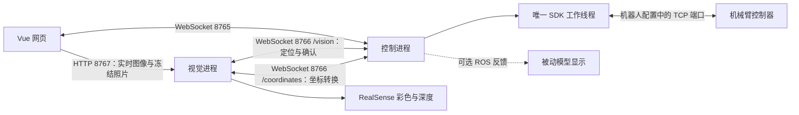
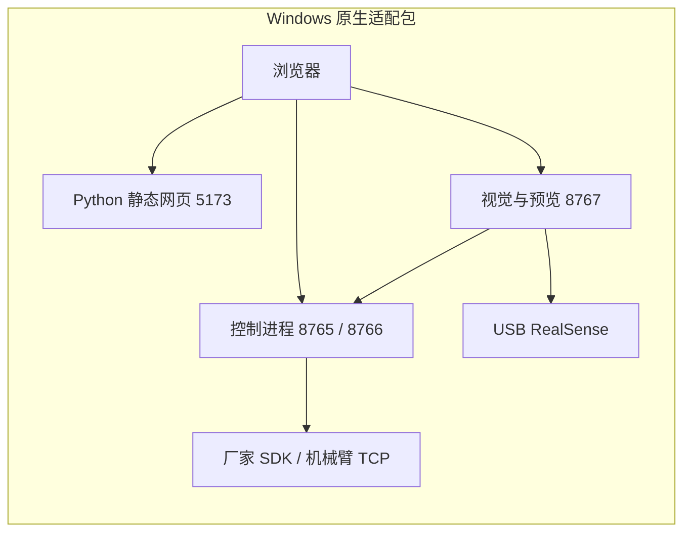

# 系统架构

本文说明当前代码中的三进程实机链路。新环境准备见 [安装说明](INSTALLATION.md)，日常启动、扫描、确认、停止和排错见 [操作说明](OPERATIONS.md)。仓库中的早期调试记录可能描述旧版本；接口以 `config/rehab_protocol/` 的 JSON Schema 和当前实现为准。

## 1. 当前能力与边界

系统把网页操作、视觉采集、机器人控制分开运行。目前真实执行入口面向**假人或工装的固定姿态无接触路线联调**：拍照识别、人工调整并确认穴位、核对深度和 SDK 可达性、显式准备和启动、完成后沿原路线返回本次起点。

方案页保留艾灸、按摩、温度和力的产品界面；真实控制后端不因此获得加热或接触按摩能力。当前联调不输出按摩力、不加热，也没有把穴位比例估算、沿用标定或虚拟模型检查暂缓标记为真人治疗验收通过。

## 2. 进程和通信

| 组成 | 当前入口 | 主要职责 |
| --- | --- | --- |
| 网页 UI | `scripts/start_web.sh`；源码 `web/src/` | 选择方案、显示实时图像/冻结照片、编辑点位、发送显式命令、显示状态与阻碍 |
| 控制进程 | `scripts/start_control.sh` → `massage_controller.node` | 反馈读取、状态机、坐标转换、版本绑定、路线预检、SDK 运动与停止 |
| 视觉进程 | `web/scripts/start_vision_preview.sh` → `vision_preview.py` | 唯一相机采集、姿态/穴位推算、冻结深度、手动点位深度重算、图像 HTTP 服务 |
| 可选模型显示 | `scripts/start_robot_mirror.sh` | 消费真实关节反馈，用 URDF 显示；不向机器人下发运动 |
| 独立仿真 | `src/elfin_massage_sim/` 与仿真脚本 | Gazebo/ROS 仿真、历史交互演示；不属于日常实机三进程入口 |

默认端点均监听本机回环地址：

| 地址 | 用途 |
| --- | --- |
| `http://127.0.0.1:5173/` | UI；日常脚本提供 `web/dist` 构建 |
| `ws://127.0.0.1:8765/` | 控制端 UI 连接；同一时刻接纳一个 UI 客户端 |
| `ws://127.0.0.1:8766/vision` | 控制与视觉任务、取消、健康状态 |
| `ws://127.0.0.1:8766/coordinates` | 视觉请求相机坐标到 Base 的转换；不发送运动 |
| `http://127.0.0.1:8767/frame.jpg` | 最新实时 JPEG |
| `http://127.0.0.1:8767/health` | 采集状态、帧龄、错误原因 |
| `http://127.0.0.1:8767/snapshot...` | 按照片身份读取冻结图像、点位或深度几何 |

这些接口没有面向公网的认证和部署设计。把 UI 部署到另一台电脑时，浏览器中的 `127.0.0.1` 指向那台电脑；仅修改网页地址不会连接原工作站。默认部署是同机使用。

## 3. 源码职责

| 路径 | 作用 |
| --- | --- |
| `web/src/views/service/ConfirmView.vue` | 最终点位、预检、现场确认、准备/开始/停止的交互 |
| `web/src/components/service/LiveAcupointPreview.vue` | 限时取图、图片解码、自动重试、页面可见性与卸载清理 |
| `web/src/stores/robot.ts` | UI WebSocket 连接与设备状态 |
| `config/rehab_protocol/` | UI、视觉、坐标 RPC 的公共报文约束和穴位字典 |
| `src/massage_controller/massage_controller/core.py` | 单事件循环业务状态机、健康检查、命令分发、失效处理 |
| `server.py` | WebSocket、有限发送队列、状态推送、坐标服务 |
| `real_device.py`、`sdk_readonly.py` | 实际反馈、SDK 连接与只读查询 |
| `base_coordinates.py`、`capture_timing.py` | 手眼变换、曝光时间与停稳反馈配对 |
| `point_confirmation.py` | 冻结照片、确认版本、最终表面坐标、场景生命周期 |
| `route_review.py`、`route_coverage.py`、`route_visibility.py` | SDK 候选路线验证、未知深度核对与诊断 |
| `noncontact_plan.py`、`noncontact_control.py` | 无接触几何生成、许可绑定与业务状态 |
| `noncontact_worker.py`、`waypoint_motion.py`、`speed_override.py` | 唯一 SDK 所有者内的运动、反馈、停止与倍率恢复 |
| `commissioning_authorization.py` | 仅对本次照片和路线有效的现场确认记录 |
| `web/scripts/vision_preview.py`、`camera_recovery.py` | HTTP 图像/照片服务、相机热插拔恢复 |
| `web/scripts/live_locate_bridge.py`、`frozen_depth.py`、`depth_scene.py` | 视觉任务桥接、冻结深度重算、可见场景分析 |
| `zhenjiu/acupoint_locator_refactored.py`、`zhenjiu/rehab_vision/` | 相机、姿态模型、穴位规则和视觉协议客户端 |

表中未写目录前缀的控制模块均位于 `src/massage_controller/massage_controller/`。

控制的 SDK 反馈与运动共用一个工作线程。路线 IK/FK 查询进入该线程的队列，并在反馈轮询间隙处理；UI、视觉、模型显示不能另建 SDK 连接。`robot_lock.py` 约束本项目的 SDK 所有者，不能代替对外部示教器或厂商软件的管理。

网页实机链路支持不依赖 ROS 的 `--standalone` 运行。控制包装脚本在原工作站优先使用已有 `.runtime/jammy`；新部署可使用 `.venv-control`，或用 `REHAB_CONTROL_PYTHON` 显式选择解释器。原生入口默认补上 `--standalone`，ROS/Gazebo 与被动模型显示需要另行安装。

## 4. 从实时画面到最终坐标

1. **实时预览**：视觉进程使用同一相机输出 RGB、深度和候选点。默认网页视觉入口使用 RTMW-L、背部模式和自动输入方向选择。候选穴位由姿态与比例规则推算，并非已完成解剖精度验收的专用穴位模型。
2. **开始扫描**：UI 发送 `SCAN`，控制端核对状态后发送 `LOCATE`。这里的扫描是停稳状态下拍照识别，不会让机械臂来回扫动。
3. **冻结本次采集**：保留该次 RGB、对齐深度、原生深度及内外参、帧号和曝光时间依据。控制端将照片与前后停稳反馈、标定摘要和 Base 变换绑定。
4. **方案筛选与拖动**：确认页显示当前方案的点和连线。医生/操作员拖动的是本次照片的二维像素位置；连线表示点位顺序，不等于已批准的机械臂运动轨迹。
5. **显式确认点位**：`CONFIRM_POINTS` 携带照片身份、UUID 版本、点名/侧别、顺序及最终像素位置。视觉通过 `REFINE_POINTS` 在同一冻结深度上重算，控制端使用同次曝光的变换生成最终 Base 表面坐标。
6. **后续变更使旧结果失效**：再次编辑、换方案、重拍、标定变化或机械臂移动，都不能继续使用旧路线许可。迟到的视觉响应不能复活已经取消的版本。

三种坐标需明确区分：照片像素坐标、相机三维坐标、机器人 Base 坐标。传给机械臂的最终目标还要根据物理工具偏移，从表面上方的工具尖端目标换算成 **Base 法兰目标**；不能把照片像素或相机 XYZ 直接当作机器人目标。

## 5. 深度场景与路线预检

`geometry_source: FROZEN_DEPTH` 使用本次冻结深度估计可见最高表面及路线周边数值范围。`workspace_base_mm`、`surface_ceiling_base_mm` 和过渡高度可以由该次场景生成；生成数值范围本身不证明整个机械臂与周围环境没有碰撞。

当前配置采用 `DIRECT_ABOVE_POINTS`：从实际读取的起始法兰位姿出发，固定当前姿态，依序经过各最终点上方的无接触目标。目标高度不低于可见最高表面加最小间隙和余量。首选入口不可达时，尝试 `CURRENT_HEIGHT_THEN_ABOVE_POINTS`，先在当前实际工具尖端高度横移到首点上方，再下降。旧配置的 `LIFT_MOVE_APPROACH` 路线仍保留兼容。

SDK 预检对去程和回程按约 10 mm 间隔采样，连续求逆解，并以正解复核位置、姿态和相邻关节变化。原点、当前姿态不可达时拒绝执行，不自动移动穴位来凑可达性。诊断区分入场段、穴位段、回程段、不可达末点和 SDK 查询超时。

未知深度单独记录。当前 `FROZEN_3D_VISIBILITY` 模式可对二维投影重叠区，用同次曝光的原生深度核对实际工具尖端路线；无效深度、遮挡、视野外或错曝光仍不通过。它只说明被核对的尖端中心线与观测的关系，不等同于工具外形、相机支架、整臂自碰撞及环境碰撞验收。

虚拟模型检查可配置为 `DEFERRED`。暂缓模型检查不会使 `full_collision_checked` 自动变成真；SDK 可达性、采集同步、实时反馈和点位绑定仍生效。

## 6. 准备、执行与返回起点

真实无接触链路使用独立命令：

| 命令 | 行为 |
| --- | --- |
| `CHECK_NONCONTACT_STOP` | 检查普通停止通路和停稳反馈；不运行路线 |
| `AUTHORIZE_NONCONTACT` | 对当前版本记录现场无障碍确认及沿用现有标定的操作决定 |
| `PREPARE_NONCONTACT` | 复核并准备本次路线；等待启动，不自动运动 |
| `START_NONCONTACT` | 对当前已准备的路线摘要显式启动 |
| `STOP` | 请求停止；停止确认后结束当前执行，不自动返回或续跑 |

单次现场确认绑定照片、最终点、标定摘要、场景、配置、候选路线及深度核对证据，并在照片采集后 300 秒内有效。它是本次假人/工装无接触试运行记录，不修改原始标定的精度验收标志。新照片必须重新确认，不可复制授权文件取得新路线许可。

当前无接触配置为固定姿态，指令速度 10 mm/s、加速度 20 mm/s²、最小离表面距离 20 mm，另加 10 mm 余量；物理工具偏移为法兰 +Z 20 mm。这些数值只描述现有工装配置，新设备必须重新核对工具和环境。现有入口的工具约束不支持随意换工具。

运动使用零 TCP/零 UCS 的 Base 法兰目标，SDK 的 `HRIF_WayPointEx(type=1, isJoint=0)` 发送直线运动。预检的密集采样点不是密集运动命令；长段按既有最大段长拆分。

启用 `temporary_speed_override: 1.0` 时，执行器在明确 START 后读取并记录原全局倍率，设置并回读本次倍率，再运动。正常结束或异常停止，必须先确认实际 STOP，之后恢复原倍率；倍率恢复失败不会报告正常完成。默认无该选项的执行不读写倍率。

`return_to_start: true` 将本次准备绑定的实测起点加入回程，沿去程折线逆序返回。回程参与同一套预检与摘要，末点保留完整起始 XYZ/Rx/Ry/Rz。只有归位、停稳、倍率恢复并核对反馈后，才报告 `COMPLETED`、`returned_to_start: true`。中途 STOP 或故障只停止，不自动执行回程。

## 7. 健康、失效与恢复

当前控制默认要求机器人反馈不超过 500 ms，视觉最新帧不超过 500 ms，UI 与视觉连接有持续存活消息。`STATUS.data.vision_feedback_valid` 表示控制端对实时视觉的判定；顶部设备连接和 HTTP 预览有画面不能替代它。

短时纯画面延迟采用分层处理：

| 情况 | 冻结照片 | 确认/执行许可 |
| --- | --- | --- |
| 空闲、停稳、实际相机会话正常，仅帧龄大于 500 ms 且小于 1.5 秒，并且未达到视觉连接超时 | 完整性仍有效时保留照片和编辑输入 | 撤销原确认和授权；同版本回 `FAILED`，恢复后人工重新确认 |
| 达到上述上限、相机断开、健康超时、采集身份失效、机器人移动、标定变化或照片超时 | 失效，需重新扫描 | 清除旧许可 |
| 单次点位深度重算超时，但照片完整性与实时健康仍有效 | 保留，可重新确认 | 本次确认失败，不保留旧许可 |
| 正在准备或执行时实时健康失效 | 不用于继续执行 | 请求 STOP；不自动恢复运动 |

相机重连会重建采集会话、时钟和内外参，清除旧帧与旧冻结几何。HTTP 和网页自动重试恢复实时画面，但不会自动重拍或重新启动路线。拔插恢复能否成功还取决于操作系统是否重新枚举设备。

## 8. 部署数据与测试边界

源码、公共协议和测试可版本管理；依赖环境、构建结果、模型下载、设备专属标定、当次授权、照片/深度、运行日志应按安装与数据管理规则分别处理。`web/.runtime/base_coordinates_latest.json` 是本机最新预览输出，不是可重放的执行指令。

新机器需要重新建立 Python/Node/可选 ROS 环境，配置 SDK、机器人网络、相机权限、模型、手眼标定与工具。仓库中的旧标定、照片和授权即使能读取，也不构成新机器验收。

离线单元测试覆盖协议、状态机、坐标/曝光完整性、编辑确认、场景、SDK 调度的假实现、停止、倍率恢复和返回起点。测试通过不替代现场精度、工具外形和实物通行空间检查；实际硬件联调需单独记录环境与结果。

## Windows 与容器入口

`windows/native_launcher.py` 在两个独立 Python 虚拟环境中启动控制与视觉，网页使用预构建静态资源。使用 Windows 系统启动身份和 Global 命名互斥体约束跨进程时钟/设备所有权，通过 CTRL_BREAK 请求正常停止。此入口仍需 Windows 曝光时序与实机验收，不能从 Linux 登记文件推断已通过。

`compose.yaml` 是独立的模拟产品：Nginx、模拟控制、模拟视觉由容器 supervisor 管理，网页通过同源 `/control` 连接，只有 `127.0.0.1:5173` 暴露到宿主机。镜像不包含真实 SDK、设备标定或 USB 相机入口。
