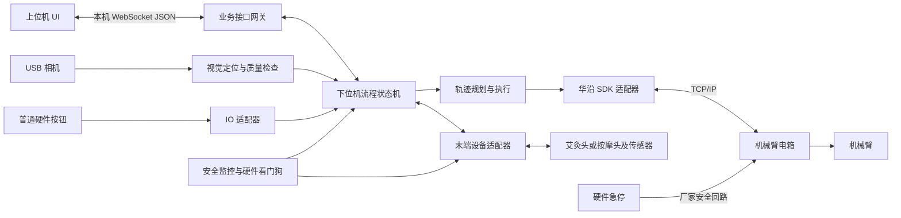
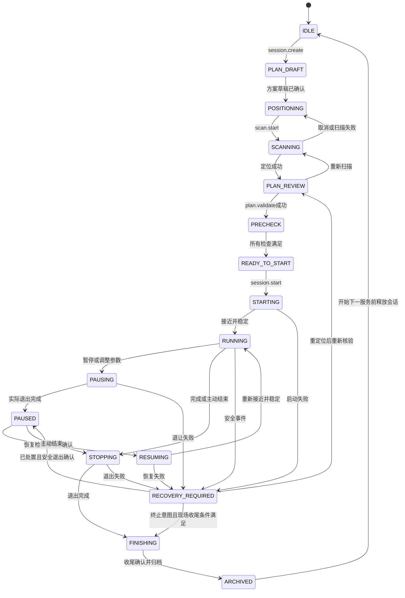
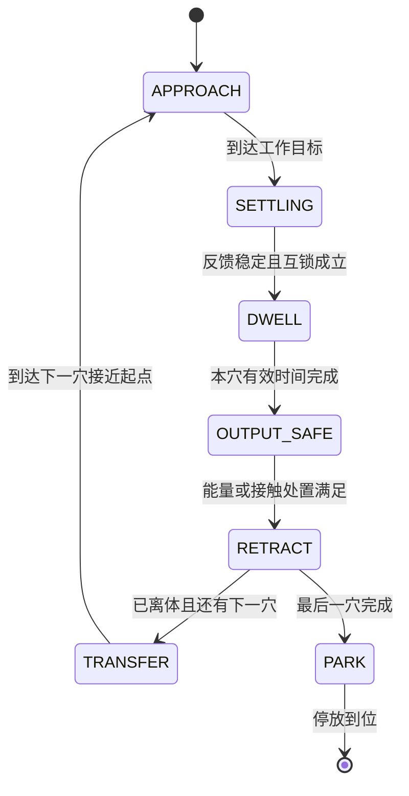

# 希康智能上下位机通讯协议与下位机状态机设计

版本：V0.1 评审稿  
日期：2026年10月8日  
适用对象：上位机 UI、工控机流程控制、视觉、机械臂与末端设备开发人员

本协议把界面操作转换为工控机上的服务流程指令。上位机提交方案和操作意图，下位机校验、规划、执行并回传真实状态；下位机通过华沿 SDK 控制机械臂电箱，通过单独的末端适配器控制或监测艾灸头、按摩头等设备。一次“开始服务”对应整段经过验证的方案执行，不需要 UI 每隔一段时间发送一个运动点。

本文定义第一版接口合同，尚不是已实现或已通过实机验证的通讯功能。温度、力、灸距、速度、计时与手法必须分字段表达，不能用一个含义不明的 `energy=50` 代替。文中的方案数值仅用于说明报文；界面原型的温度与调节范围不构成实机安全限值或治疗参数依据。

## 1 资料依据与实现边界

| 资料 | 本文采用的内容 | 限制 |
|---|---|---|
| [服务流程界面 PDF](希康智能_服务流程界面_图片版.pdf)，共14页 | 页面流程、按钮、温度与灸距、方案路线、暂停及归档需求 | 多处明确标注本地模拟；只展示问卷第1题，没有全部题目或所有弹窗 |
| 用户提供的架构图 | 相机 USB、硬件按钮 IO、UI 内嵌工控机、工控机网口连接电箱 | IO 模块、末端控制链路及安全回路未标明 |
| [华沿 Python SDK 手册](../SDK/HUAYAN/python%20API接口/HuayanRobot_Library_Python_V1.1.1.1.pdf)与[CPS.py](../SDK/HUAYAN/python%20API接口/HuayanRobotPythonSDK_V1.1.1.1/CPS.py) | SDK 接口名称、参数与实际拼包方式 | 包目录为V1.1.1.1，源码头部另有V1.1.1.0标记；对接时应记录文件哈希与实际控制器版本 |
| [华沿 V6 通讯协议](../SDK/HUAYAN/HuayanRobotV6控制通信协议接口_V1.0.19.1.pdf) | 第1.2节执行回执；第2章报文；第3.2节端口；第4.5.20节状态；第5.1节推送帧 | 是否匹配首台控制柜尚需确认，不混用不同版本协议 |
| [现有 HMI 说明](../HMI.md)与[硬件说明](../HARDWARE.md) | 视觉配准版本、坐标与时间同步、独立规划及实机接入边界 | 现有实机接入层只读；仿真未实现真实接触力控和持续人体跟踪 |

文中“规定”表示本项目拟采用的业务协议；“SDK 已有”只表示本地资料中存在该接口；“待确认”表示上线依赖。未出现的弹窗、其余问卷题目与按摩专用页面不虚构为已确认需求。

## 2 上下位机的职责和连接

本项目的“上位机”指 UI 进程，“下位机”指部署在 Ubuntu 22.04 / ROS 2 Humble 工控机上的控制后端。二者可以运行在同一台工控机；机械臂电箱是后端连接的控制器，不是 UI 的业务协议服务端。



第一版选用本机 `ws://127.0.0.1:8765/control/v1`，端口8765为本项目建议值，可配置。UI 与后端之间一条 WebSocket 文本消息就是一个 UTF-8 JSON 对象，不用换行分包。单消息建议上限256 KiB；图像不塞入控制消息，采用独立预览通道，只传 `frame_id` 等引用。远程 UI 若后续需要，另行配置 WSS、认证和权限；不直接监听所有网卡。

后端内部建议划分 `workflow_manager`、`vision_service`、`trajectory_executor`、`huayan_adapter`、`tool_adapter`、`io_adapter`、`safety_supervisor` 与记录服务。ROS 2 服务用于短请求，Action 用于扫描/执行等可取消长任务，Topic 发布状态。网关负责 JSON 与内部类型转换；第一版不同时开放多套可写控制入口。ROS 通道和软件优先级均不替代硬件安全回路。

| 层次 | 负责 | 不应负责 |
|---|---|---|
| UI | 选择方案、参数输入、操作确认、状态显示 | 生成关节角、控制实时闭环、用本地倒计时宣布完成 |
| 下位机 | 方案版本、状态机、计时、互锁、坐标转换、规划、停止、审计 | 未经现场配置把 UI 原型限值当实机限值 |
| 华沿适配器 | 控制柜连接、运动/状态/故障/力控接口映射 | 直接解释业务“肩颈方案” |
| 末端适配器 | 工具识别、温度/力/功率反馈、允许时启停输出、净烟联动 | 假定所有艾灸头都能电控熄火 |

## 3 从点击到执行的完整流程

```text
打开 UI → 握手与状态快照 → 创建匿名服务会话
完成问卷 → 确认方案草稿 → 就位 → 开始扫描
扫描成功 → 下位机返回定位结果 → UI 调整穴位与参数
提交最终方案 → 下位机校验和预规划 → 人工及自动启动检查
长按开始 → 下位机锁定方案版本 → 接近首穴 → 穴位停留/手法
抬离 → 过渡到下穴 → 重复执行 → 正常退出 → 人工收尾 → 归档
```

视觉扫描成功不等于路线可执行；方案通过校验不等于允许立即开始；SDK返回0不等于运动完成。每一步均由下位机给出结果后解锁下一步。

## 4 页面操作与指令对照

页码采用原 PDF 物理页码。标为“本地”的操作不发送机械臂命令；需保存的业务数据可以发送业务请求。以下 `payload` 写法为字段摘要，完整公共信封见第5节。

| 页码和界面操作 | 指令或处理 | 关键参数与前置条件 | 下位机结果和 UI 行为 |
|---|---|---|---|
| 1 打开服务首页 | `system.hello`、`system.get_snapshot` | UI协议版本、客户端标识 | 显示实机/演示模式、连接、自检与可操作项 |
| 1 开始选择方案 | `session.create` | `service_type`可暂为`UNSELECTED` | 返回匿名`session_id`，进入问卷 |
| 2 选项、下一题、返回首页 | 本地切题；完成问卷后`session.set_screening` | `screening_version`、`eligible_modalities`、确认摘要 | 不发送运动指令；不适用的服务类型不能被后续换方案绕过 |
| 3 换方案、返回修改问卷 | 本地切换；确认时`plan.set_draft` | 方案模板ID/版本、服务类型、筛查版本 | 返回`plan_revision`；修改筛查使旧方案确认失效 |
| 3 确认并准备就位 | `plan.set_draft`成功后导航 | 模板中时间/手法均展开成显式字段 | 进入就位页，不自动移动机械臂 |
| 4 就位检查 | `checklist.confirm` | 人工项ID、确认结果；传感器项由后端产生 | 区分人工已确认、自动已检测、未知三种来源 |
| 4 开始扫描 | `scan.start` | `session_id`、`plan_revision`、`scan_profile_id` | `SCANNING`；异步回传进度与结果 |
| 4 上一步 | 本地导航；若修改方案则重新提交 | 只在没有运行中的扫描/服务时返回 | 导航不隐式改变运行状态 |
| 5 取消扫描 | `scan.cancel` | `scan_task_id` | 确认取消后回`POSITIONING`，旧结果不能迟到生效 |
| 5 演示扫描失败 | `simulation.inject_fault` | 仅`mode=SIMULATION`、`fault=SCAN_FAILED` | 实机模式不提供此能力 |
| 6 拖动穴位微调 | 拖动时本地预览；松手发`target.adjust` | 穴位实例ID、定位版本、图像帧/像素或人体坐标增量 | 下位机回算三维点与法向，校验允许区域；返回新修订和预览 |
| 6 改时间/目标温度/灸距 | 编辑本地草稿 | 分钟换算毫秒，cm换算mm | 尚不执行；显示单位与提交值分离 |
| 6 重新扫描 | `scan.start` | 新`request_id`，当前会话 | 立即废弃定位确认、已规划轨迹及启动检查令牌 |
| 6 确认路线并进入检查 | `plan.validate` | 完整计划、`plan_revision`、`registration_id` | 成功返回`plan_token`、规范化参数与摘要；失败返回字段级原因 |
| 7 艾条装入/净烟/床就位等确认 | `checklist.confirm` | `item_id`、`confirmed`、`plan_token`、操作人角色 | 人工项留审计，自动项不能由UI伪造 |
| 7 手动点火完成长按 | `checklist.confirm` | `item_id=ignition_completed`、`hold_ms` | 仅记录手动点火已完成，不发送“点火”SDK命令 |
| 7 完成检查后长按启动 | `session.start` | `plan_token`、`checklist_token`、`hold_ms` | 二次核验全部条件后进`STARTING`；不因按钮变绿直接显示运行 |
| 8 语音播报 | UI本地播报当前后端状态 | 不含机械臂操作 | 若部署独立语音服务，另作业务接口 |
| 8 暂停 | `session.pause` | `reason=OPERATOR` | 先`PAUSING`；退让确认后才`PAUSED` |
| 8 调温/调距 | `session.update_parameters` | 当前生效修订、新目标、`apply_policy=PAUSE_REVALIDATE` | 第一版自动发起暂停退让，再校验应用；不在接触/加热过程中突变 |
| 8 结束服务 | `session.stop` | `reason=OPERATOR_END` | `STOPPING`→`FINISHING`，保留部分完成数据 |
| 9 继续服务 | `session.resume` | 恢复令牌、当前计划及定位修订 | 检查仍有效后`RESUMING`，到位后再计时 |
| 9 调整参数 | `session.update_parameters` | 与第8页相同 | 只在暂停稳定状态提交生效 |
| 9 结束服务 | `session.stop` | 与第8页相同 | 不继续剩余穴位 |
| 10 已处理，继续 | `fault.acknowledge`→`session.prepare_resume`→`session.resume` | `fault_id`、处置记录；缺定位时先重扫 | 此按钮应分步呈现检查结果，确认故障不直接清故障并运动 |
| 10 结束服务 | `session.stop` | 任何活动流程可提出 | 故障或急停条件仍存在时不强行移动，只登记终止意图 |
| 11 熄灭取出、清灰/补艾/消毒 | `checklist.confirm` | 收尾项与会话关联 | 熄灭需人工确认或有效传感器证据；停臂不等于熄火 |
| 11 顾客感受、备注、完成并归档 | `session.archive` | 收尾令牌、感受、无身份信息备注 | 写入权威时长、参数历史、结果；成功后`ARCHIVED` |
| 11/12 查看服务记录，14筛选 | `record.list` / `record.get` | 分页、类型、状态、服务ID | 只读，不改变设备状态 |
| 12 更换后复位耗材 | `maintenance.reset_consumable` | 耗材类型、实物更换确认 | 维护权限且无活动服务；只重置耗材计数，不复位机器人故障 |
| 12 标记已查看、打烊清单 | `maintenance.confirm` | 项目ID、确认结果 | 记录人工完成，不自动断电或移动 |
| 12 立即自检 | `device.self_test` | 无运行中的服务、具备维护权限 | 异步检查设备；默认无运动，无加热，无自动点火 |
| 13 音量、静音、屏幕亮度 | `ui.preferences.set`或UI本地 | 对应偏好值 | 无机器人命令 |
| 13 安全温度上限二次确认并保存 | `safety_policy.update` | 管理权限、旧策略版本、新值、再次确认 | 仅空闲维护态；受已批准硬限值约束，改变后旧令牌失效 |
| 13 数据导出 | `record.export` | 数据类别、后端枚举的目标介质ID | 异步返回成功/空间不足/介质移除，不接受任意系统路径 |
| 13 关于、维护入口、返回主页 | 本地导航/权限检查 | 维护入口不能在活动服务中开启手动运动 | 返回主页不停止正在进行的服务 |
| 13 演示模式、模拟U盘异常 | 独立模拟后端或`simulation.*` | 仅空闲态切换，实机适配器断开且输出禁止 | 水印和会话模式明确；模拟结果不能解锁实机 |
| 14 全部/艾灸/按摩/已完成/提前结束 | `record.list` | 对应过滤条件 | 记录页仅展示，不发运动或使能指令 |

第7页按摩检查清单应按工具识别、消毒与接触条件生成，具体条目尚待补充页面。PDF的“长按2秒”是手动点火确认要求；第一版建议启动也使用2秒，但属于新增交互约定。长按只防误触，不是硬件安全功能。

## 5 公共通讯信封和事务规则

### 5.1 请求格式

```json
{
  "protocol_version": "1.0",
  "message_type": "command",
  "request_id": "req-start-0001",
  "client_id": "hmi-main",
  "controller_epoch": "boot-20261008-001",
  "lease_id": "lease-001",
  "session_id": "srv-demo-001",
  "command": "session.start",
  "expected_state_revision": 42,
  "sent_at": "2026-10-08T10:00:00+08:00",
  "ttl_ms": 2000,
  "payload": {
    "plan_token": "plan-token-003",
    "checklist_token": "check-token-003",
    "hold_ms": 2100
  }
}
```

| 字段 | 类型与规则 |
|---|---|
| `protocol_version` | 字符串。首版`1.0`；不支持的主版本拒绝，未知命令与未知危险控制字段拒绝 |
| `message_type` | `command`、`ack`、`event`、`snapshot`之一 |
| `request_id` | 客户端生成唯一字符串，建议UUID；一次意图一个ID，重传沿用原ID |
| `client_id` / `lease_id` | 控制客户端身份与服务端颁发的控制租约；身份不依靠字符串自报，需本机认证凭证 |
| `controller_epoch` | 后端每次启动生成的新标识，旧进程的令牌/命令不得用于新进程 |
| `session_id` | 服务关联ID；握手、创建会话、设备级请求为`null` |
| `expected_state_revision` | 整数，引用最近权威状态修订；不匹配拒绝状态相关修改。遥测刷新不增加该修订 |
| `sent_at` / `ttl_ms` | 有时区时间与最大接收延迟。第一版本机共享系统时钟；启动前检测时钟异常。接收后截止期改用单调时钟 |
| `payload` | 命令专用对象，所有数值必须有限，拒绝NaN/Infinity、类型混用与省略必填项 |

握手例外：`system.hello`不要求租约、epoch和状态修订，由响应返回当前epoch、状态快照、`capabilities`及申请租约方法。设备查询不要求服务ID。`session.stop`和`session.pause`在认证且会话相符时允许修订过期，以免状态变化妨碍停止；不得因停止请求本身增加能量或恢复运动。重复停止返回当前处理结果。急停事件来自硬件，不依赖这些字段。

### 5.2 接收与完成分别回复

```json
{
  "protocol_version": "1.0",
  "message_type": "ack",
  "request_id": "req-start-0001",
  "controller_epoch": "boot-20261008-001",
  "session_id": "srv-demo-001",
  "status": "ACCEPTED",
  "code": "OK",
  "operation_id": "op-start-001",
  "state_revision": 43
}
```

```json
{
  "protocol_version": "1.0",
  "message_type": "event",
  "controller_epoch": "boot-20261008-001",
  "event_id": 108,
  "session_id": "srv-demo-001",
  "request_id": "req-start-0001",
  "operation_id": "op-start-001",
  "event": "operation.completed",
  "status": "SUCCEEDED",
  "state_revision": 45,
  "data": {"workflow_state": "RUNNING", "phase": "DWELL", "point_id": "p-dazhui"}
}
```

`ack.status`取`ACCEPTED`或`REJECTED`；拒绝必须带错误码、原因和必要的当前修订。异步终态取`SUCCEEDED`、`FAILED`、`CANCELED`、`UNKNOWN`。`UNKNOWN`表示已发送到设备但结果不可确认，必须协调恢复，不能按失败自动重发运动。长操作有且只有一个逻辑终态，重复查询返回同一结果；事件网络投递可能重复，UI按`epoch + event_id`去重。

`session.start`操作完成只表示已启动并进入服务，整次服务结束另发`session.finished`。`session.pause`完成必须是实际退让确认；`session.stop`完成必须是输出处理及可实施的退出动作完成，否则返回故障或未知，不伪报成功。

### 5.3 顺序、重试和断线

1. 下位机只允许一个业务控制写入者。控制租约建议每1秒续约、3秒到期；读状态客户端可多个。断联保护时限属于初始软件配置，需按实机风险和响应能力验收，不能代替硬件看门狗。
2. 接收请求先检索幂等记录，再校验修订；相同ID与相同语义内容返回已有结果，相同ID但内容不同返回`REQUEST_ID_CONFLICT`。先持久化受理及执行意图，再交设备；记录保存至少覆盖会话和设备恢复窗口，建议不少于24小时。
3. 在网络超时但epoch未变时，UI先发`operation.get`查询原`request_id`，必要时原样重传，不能产生新的启动ID。后端重启后旧epoch请求拒绝；已受理未完成动作记为`UNKNOWN`，核对真实设备状态后恢复。
4. 不能承诺跨电源故障的物理动作“严格一次”。业务去重防重复启动，设备执行结果不明时禁止盲目重放。
5. 建议ack目标200ms、UI等待1秒后查询；不是在1秒内运动完成。扫描建议超时30秒（UI提示10至20秒是预估）；规划、运动、退让等使用各阶段已批准的超时配置。
6. 心跳为应用级`system.heartbeat`，不能只看TCP还连接。租约到期停止接受新运动，触发保护处理；连接恢复先快照同步，不自动继续。
7. 事件带递增`event_id`。重连用`system.get_snapshot`和`event.get_since`；超出保留窗口时以快照和操作查询为准，检测到序号缺口不得凭旧按钮状态继续。
8. UI与后端都不可把本地系统时间用于累加服务时长；截止与累计使用单调时钟，UTC时间仅供日志。协议远程部署时需另定义时钟偏差处理。

### 5.4 令牌绑定与失效

`plan_token`是后端生成的不可伪造引用，绑定会话、epoch、规范化计划hash、定位/曲面、工具/TCP、筛查与安全策略版本。`checklist_token`另绑定检查项结果、人工确认时间及自动检查证据；`resume_token`另绑定暂停检查点和剩余服务数据。令牌不替代实时互锁，持有正确令牌也可能因新故障被拒绝。

响应应携带`expires_at`和`expires_in_ms`，下位机以单调时钟保存实际期限。建议恢复令牌有效30秒、人工启动检查有效5分钟作为评审初值；定位有效期及各项传感器新鲜度必须由设备策略确定，不能直接套用这两个时限。计划令牌有效期不超过其依赖中最早到期项。策略中没有定位时效/运动有效性规则时，不发布实机可执行令牌。

对已运行服务，启动令牌到期本身不造成无意义的自动中断，持续运行由实时许可及阶段策略控制；恢复、参数修改或再次开始均需取得当前有效令牌。任何依赖版本变更立即使待启动/恢复令牌失效。会话关闭后其全部令牌作废。

### 5.5 最小控制和查询接口

| 命令 | payload必填或说明 | 返回数据 |
|---|---|---|
| `system.hello` | `supported_versions`、`client_build`、认证信息 | 协商版本、epoch、mode、capabilities |
| `control.acquire` / `control.release` | 授权后的控制权申请/归还 | `lease_id`、有效期；活动中归还触发保护处理 |
| `system.heartbeat` | `lease_id`、最近接收事件ID | 租约剩余时间、服务端时间 |
| `system.get_snapshot` | 空对象 | 完整权威快照 |
| `operation.get` | `request_id`或`operation_id`，必须明确其一 | 状态、终态、错误、结果 |
| `event.get_since` | `after_event_id`、`limit` | 事件列表或`SNAPSHOT_REQUIRED` |
| `session.create` | 服务类型或`UNSELECTED` | 会话ID |
| `session.set_screening` | 筛查版本、允许服务类型、摘要 | 绑定会话的筛查结果 |
| `plan.set_draft` | 模板ID/版本、服务类型、筛查版本 | 草稿修订 |
| `scan.start` / `scan.cancel` | 扫描配置/扫描任务ID | 操作ID、定位结果/取消结果 |
| `target.adjust` | 定位ID、穴位ID、位置输入、基础修订 | 规范化三维目标、新修订 |
| `plan.validate` | 完整`plan`对象（含草稿修订） | 规范化plan、hash、plan_token、可执行性和时长预估 |
| `checklist.confirm` | `item_id`、`confirmed`、对应plan_token或收尾上下文 | 清单状态；全部满足后生成清单令牌 |
| `session.start` | plan_token、checklist_token、hold_ms | 启动操作ID |
| `session.pause` / `session.stop` | `reason` | 暂停/结束操作ID |
| `session.update_parameters` | 基础参数修订、changes、apply_policy | 生效/拒绝结果、新参数修订、恢复前检查要求 |
| `fault.acknowledge` | fault_id、处置说明 | 已确认、仍活动/已消除；不自动复位 |
| `session.prepare_resume` | 当前plan_token、故障/检查上下文 | 短时有效resume_token或需重扫/重检原因 |
| `session.resume` | resume_token | 恢复操作ID |
| `session.archive` | 收尾清单令牌、反馈 | 归档ID和最终结果 |
| `device.reset_fault` | fault_id、现场确认、维护身份 | 复位结果；不启用、不继续运动 |
| `device.self_test` | 检查配置ID | 检查报告 |
| `maintenance.reset_consumable` | 耗材类型、更换确认 | 新计数、审计记录 |
| `maintenance.confirm` | 项目ID、确认结果 | 审计ID |
| `safety_policy.update` | base_revision、新策略、二次确认 | 策略修订；硬限值范围外拒绝 |
| `record.list` / `record.get` | 过滤分页/服务ID | 匿名记录与参数摘要 |
| `record.export` | 类别、介质ID | 导出操作及结果 |

## 6 方案参数如何构造

### 6.1 时间、能量、停留、过渡四组参数

| 分组 | 字段 | 含义与校验 |
|---|---|---|
| 时间 | `duration_basis` | 首版固定`ACTIVE_TREATMENT`，只累计满足条件的穴位服务时间 |
| 时间 | `total_active_ms` | 总有效服务时间，整数毫秒，大于0且受设备批准上限约束 |
| 时间 | `dwell_ms` | 每个穴位实例每次到访的有效时间，不包含接近、过渡、暂停 |
| 时间 | `repeat_count` | 路线循环次数，正整数；总时间必须等于各穴位时间之和乘循环次数 |
| 时间 | `max_wall_ms` | 含暂停、调整、过渡的会话最长执行墙钟时长；以单调时钟计算，超时结束或故障 |
| 能量 | `modality` | `MOXA`或`MASSAGE`；一份计划只能选一种，换工具/类型需新计划 |
| 艾灸 | `intensity.mode=THERMAL_TARGET` | 分开设置温度目标与几何间隙；不隐含存在自动调温闭环 |
| 艾灸 | `temperature_target_c` / `temperature_measurement_site` | 温度及其测量位置，例`SKIN_SURFACE`；测量位置未确认时实机计划不通过 |
| 艾灸 | `gap_target_mm` | 发热端参考面到局部皮肤表面的法向间隙；不是相机到人体原点距离 |
| 可控热源扩展 | `intensity.mode=POWER_TARGET`、`power_target_w` | 仅能力明确支持、经校准且配有温度限制的电控热源使用；V0.1默认禁用 |
| 按摩 | `intensity.mode=FORCE_TARGET`、`normal_force_target_n` | 沿人体表面法向的压入作用力正值；由适配器转换到传感器轴及正负号 |
| 力控配置 | `force_profile_id` | 绑定工具、传感器、零点、重力补偿、控制参数与最大接触偏差，不由UI任意修改 |
| 停留 | `dwell.mode` | `STATIC`定点、`ORBIT`回旋、`SWEEP`往返；`PECK`雀啄作为扩展，默认不开放 |
| 过渡 | `transition.mode` | 首版`RETRACT_TRANSFER_APPROACH`：抬离、移动、接近；沿面带能量过渡默认禁用 |
| 工具 | `tool_id`、`tcp_revision` | 绑定工具及其TCP标定；更换工具使原计划失效 |
| 定位 | `registration_id`、`surface_revision` | 绑定同一次人体定位及曲面版本，不能混用旧穴位与新曲面 |
| 策略 | `safety_policy_id` / `safety_policy_revision` | 下位机已批准参数边界，不允许客户端扩大限制 |

**“能量大小”不直接用焦耳表示。** 温度是温度，力是力，功率是功率；没有经过标定的功率反馈不能由温度×时间推算已输出能量。若将来需要剂量J，只能积分有效的实际功率反馈，并单独说明是设备输出能量还是组织吸收能量。UI可显示“低/中/高”，但后端必须用已标定的档位表展开成明确目标并回传，不能只传档位数字。

对手动点火的燃烧艾条，`temperature_target_c`先表示方案目标及监测参考。若没有调温执行机构或经验证的调距控制器，应返回`THERMAL_REGULATION_UNSUPPORTED`，不能声称自动达到目标；可另发布明确的“定距加监测”能力配置。燃烧不会因`tool.disable`而自动停止。

### 6.2 停留方式

| 模式 | 参数 | 几何语义 | 首版处理 |
|---|---|---|---|
| `STATIC` | `dwell_ms` | 目标穴位及法向姿态固定，保持批准的间隙或力目标 | 验证通过后开放 |
| `ORBIT` | `radius_mm`、`angular_speed_deg_s`、`direction=CW/CCW` | 在穴位局部切平面回旋，曲面投影后维持批准的法向间隙 | 对曲率、可达性、速度及整圈覆盖做预规划后开放 |
| `SWEEP` | `half_length_mm`、`axis_angle_deg`、`speed_mm_s` | 围绕中心沿切平面方向往返；振幅是半长 | 验证转向加速度及边界后开放 |
| `PECK` | `amplitude_mm`、`frequency_hz`、`min_gap_mm` | 沿局部法向往复 | 尚无对应界面需求与实机验证，能力列表默认不含该模式 |

圆周方向规定为从体外沿负法向看向皮肤时的顺/逆时针。任意模式的整段轨迹都必须落在允许区域，不是只验证圆心。半径、速度和时长互相约束，不能独立放大。规划器将业务手法展开为设备轨迹，UI不发送一串无校验的SDK指令。

### 6.3 穴位过渡方式

`RETRACT_TRANSFER_APPROACH`固定采用以下顺序：暂停有效计时 → 处理热源/解除接触力 → 沿已验证方向离开 → 确认安全间隙 → 沿预规划路径去下一穴上方 → 按目标法向接近 → 等待传感器与控制条件稳定 → 开始下一穴计时。

`clearance_profile_id`引用已批准的离体距离、抬离速度、跨穴速度、接近速度、加速度与超时；这些配置在能力查询中可查看。首版不由UI填写任意“安全距离”。直线连接两个穴位会穿过人体曲面或障碍，必须做全段碰撞与间隙检查。不能用未经规划的`MoveJ`直接横穿人体上方。

后续若增加`SURFACE_FOLLOW`连续循迹，应独立声明曲面跟踪、力/温度闭环、人体运动检测能力及过渡期间是否计时、是否带能量。V0.1收到该模式返回`UNSUPPORTED_MODE`。

### 6.4 计时和默认值规则

有效时间只在`RUNNING/DWELL`且定位、传感器、目标控制条件均有效时增加。不稳定时进入`SETTLING`或保护暂停，不能无限停留并悄悄延长局部暴露；同时受阶段超时、墙钟上限及独立的连续热暴露/接触时长上限约束。

每穴完成进度由有效时长确定；提前结束保留剩余时长，恢复从剩余时间继续，不从零重做。UI显示“剩余服务时间”和“预计结束时间”时需区分有效时长与含过渡的预估墙钟时长。修改总时长低于已完成时长直接拒绝。

第一版全部点的停留、过渡参数必须显式给出，无隐藏继承。模板在`plan.validate`前展开；总时长和分配不一致返回`DURATION_MISMATCH`，不由下位机偷偷均分。没有产品确认的数值不设置实机默认值。

### 6.5 完整艾灸计划示例

以下是演示模式结构示例：30分钟按3穴各10分钟展开，温度47°C及灸距30mm来自界面示例，回旋半径等其余值为报文演示值。定位引用和策略ID均是占位，不能通过实机校验。

```json
{
  "plan_id": "plan-demo-001",
  "plan_revision": 3,
  "mode": "SIMULATION",
  "template_id": "P-01",
  "template_revision": 1,
  "modality": "MOXA",
  "tool_id": "demo-moxa-head",
  "tcp_revision": "demo-tcp-1",
  "registration_id": "demo-reg-1",
  "surface_revision": 1,
  "safety_policy_id": "demo-policy",
  "safety_policy_revision": 1,
  "duration_basis": "ACTIVE_TREATMENT",
  "total_active_ms": 1800000,
  "max_wall_ms": 2700000,
  "repeat_count": 1,
  "points": [
    {
      "point_id": "p-dazhui",
      "acupoint_code": "GV14",
      "display_name": "大椎",
      "target_ref": "demo-reg-1/target-1",
      "dwell_ms": 600000,
      "intensity": {"mode": "THERMAL_TARGET", "temperature_target_c": 47, "temperature_measurement_site": "SKIN_SURFACE", "gap_target_mm": 30},
      "dwell": {"mode": "ORBIT", "radius_mm": 5, "angular_speed_deg_s": 30, "direction": "CW"},
      "transition": {"mode": "RETRACT_TRANSFER_APPROACH", "clearance_profile_id": "demo-clearance"}
    },
    {
      "point_id": "p-jianjing-left",
      "acupoint_code": "GB21_L",
      "display_name": "左肩井",
      "target_ref": "demo-reg-1/target-2",
      "dwell_ms": 600000,
      "intensity": {"mode": "THERMAL_TARGET", "temperature_target_c": 47, "temperature_measurement_site": "SKIN_SURFACE", "gap_target_mm": 30},
      "dwell": {"mode": "ORBIT", "radius_mm": 5, "angular_speed_deg_s": 30, "direction": "CW"},
      "transition": {"mode": "RETRACT_TRANSFER_APPROACH", "clearance_profile_id": "demo-clearance"}
    },
    {
      "point_id": "p-jianjing-right",
      "acupoint_code": "GB21_R",
      "display_name": "右肩井",
      "target_ref": "demo-reg-1/target-3",
      "dwell_ms": 600000,
      "intensity": {"mode": "THERMAL_TARGET", "temperature_target_c": 47, "temperature_measurement_site": "SKIN_SURFACE", "gap_target_mm": 30},
      "dwell": {"mode": "ORBIT", "radius_mm": 5, "angular_speed_deg_s": 30, "direction": "CW"},
      "transition": {"mode": "RETRACT_TRANSFER_APPROACH", "clearance_profile_id": "demo-clearance"}
    }
  ]
}
```

最后一个点的`transition`用于该点退出，实际跨穴步骤在最后一循环末跳过，进入收尾。`point_id`是路线实例ID，`acupoint_code`是业务标签，不足以确定人体上的实际坐标。

按摩点的`intensity`替换为如下结构，艾灸字段必须删除。15N只取自PDF记录页示例，不是可直接采用的力控目标。

```json
{
  "mode": "FORCE_TARGET",
  "normal_force_target_n": 15,
  "force_profile_id": "demo-force-profile"
}
```

### 6.6 运行中参数调整示例

```json
{
  "base_parameter_revision": 3,
  "scope": "CURRENT_AND_REMAINING",
  "apply_policy": "PAUSE_REVALIDATE",
  "changes": {
    "temperature_target_c": 47,
    "gap_target_mm": 40
  }
}
```

此对象是`session.update_parameters`的payload。首版允许的changes只有同一服务类型下的温度/灸距或力目标；时长、穴位位置、路线顺序、停留模式、工具及服务类型改变走完整计划修改与重验证，不能使用任意JSON路径补丁。整个变更原子提交，不允许只改成功一半。

暂停后重新生成计划hash和plan_token，清除旧恢复令牌及受影响检查项；重新检查并取得resume_token后才能继续。回执包含规范化目标、生效时间、parameter_revision以及未采用的字段错误；拒绝时旧参数全部保留。

## 7 定位数据和坐标约定

上位机优先提交`target_ref`，让下位机持有带曲面法向的三维目标。微调可发显示图像帧上的`pixel_uv`和`image_frame_id`，或显式`frame_id=human_registered`的毫米偏移，二者互斥。下位机使用该帧对应深度、内参、外参重算，返回真实调整量；不能把2D界面拖动的30像素当30mm。

目标记录至少包含：`target_ref`、`registration_id`、`captured_at`、`source_frame_id`、`frame_id`、`position_mm[3]`、`normal[3]`、`tangent_x[3]`、质量值、允许区域与调整依据。法向为指向体外单位向量，切向与法向正交。人体坐标的方向、原点与机器人基座变换由当前定位版本提供，不假设所有人朝向相同。

下位机内部ROS几何量统一用m/rad；业务接口用带单位字段名的mm/deg；SDK适配层按厂家约定转成mm与角度。姿态内部推荐单位四元数`[x,y,z,w]`。SDK的Rx/Ry/Rz旋转约定必须通过当前版本文档和已知姿态验证后转换，不能把ROS欧拉角未经确认直接填入。

```text
p_base_surface = T_base_human(registration_id) × p_human_surface
p_base_tool_reference = p_base_surface + gap_mm × n_base_outward
```

第二式描述热端参考面位置，转换到机器人TCP还要使用实测工具几何；不能把法兰位置当热端位置。相机到人体原点距离、背部深度中位数均不能直接作为灸距或接触间隙。真实温度/距离检测位置须与控制目标一致。

重新扫描、人体移动、床位变化、相机外参/TCP改变、工具更换均使相关令牌失效。暂停期间检测到人体移动必须重扫；缺少持续人体运动检测能力时，不能把旧定位一直广播解释为定位仍有效。实机启用所需的位姿有效性保障方式应写入设备能力与安全策略。

## 8 下位机状态机

### 8.1 用三层状态避免互相混淆

1. **设备与安全状态**描述能否连接、控制与运动。
2. **服务流程状态**描述本次服务到哪一步。
3. **执行阶段状态**描述当前正在接近、停留或跨穴。

厂商`ReadCurFSM`只作为设备适配器输入，不直接替代业务流程状态。一个`Moving`无法说明当前是服务、退让还是返回停放位。安全状态与业务状态都在快照中展示，急停永远覆盖业务运动许可。

### 8.2 设备与安全状态

| 状态 | 含义 | 进入/退出规则 |
|---|---|---|
| `BOOTING` | 启动、读配置、核对持久化未结束会话 | 输出默认禁止，不重放历史运动 |
| `CONNECTING` | 连接控制柜、工具、相机、IO | 连接成功仍需检查遥测与版本 |
| `NOT_READY` | 未使能、校准缺失或检查未通过 | 明确列出缺项，不能开始服务 |
| `READY` | 当前设备配置和健康检查满足要求 | 只是设备就绪，仍受流程和计划检查约束 |
| `PROTECTIVE_STOP` | 可恢复保护，例如定位失效、温度/力异常 | 停止输出/运动；仅在运动仍获许可且退出路径可信时退让 |
| `FAULT` | 设备故障、阶段超时、关键执行结果不明 | 保持锁存，处置与复位后回`NOT_READY` |
| `ESTOP` | 急停有效 | 硬件链路制止运动；不发退让/继续；释放后仍需复位和检查 |
| `DISCONNECTED` | 控制柜或关键工具通信不可用 | 实际姿态/输出可能未知；不能声称已经停止或安全退回 |

安全许可由所有条件共同决定，不采用“最后一个事件覆盖前一个故障”。例如急停释放但控制柜仍断联，应进入`DISCONNECTED`，不能直接进入`READY`。急停与故障原始位同时保留，界面给出最高优先级原因。

### 8.3 服务流程状态图



图只画主要路径；全局规则补充：任何非归档态的急停、关键设备断联或不可恢复故障均进入`RECOVERY_REQUIRED`；所有活动态均接受停止意图，未开始的流程可以无运动取消后收尾。`STARTING`/`RESUMING`中收到暂停也走`PAUSING`。计划或检查过期使`READY_TO_START`回到`PRECHECK`或`PLAN_REVIEW`。在`PAUSED`重新扫描成功后进入`PLAN_REVIEW`，保留已完成时长，不能作为新会话重新累计。

### 8.4 执行阶段状态图



`DWELL`内执行定点、回旋或往返手法。状态机每次只管理一个具有设备动作ID的有效运动段。每段都有前置条件、取消标识、截止期、反馈完成判据；SDK成功仅表示发出。无需等待整个10分钟的阻塞函数返回，使用事件/定时器驱动。

### 8.5 关键状态转换表

| 当前状态与事件 | 守卫条件 | 进入动作 | 成功判据/后继状态 | 失败处理 |
|---|---|---|---|---|
| `READY_TO_START` + start | 控制权、令牌、筛查、设备健康、定位、工具、实时互锁全部有效 | 锁定plan/hash；记录起点；执行接近 | 到位及输出条件稳定→`RUNNING` | `RECOVERY_REQUIRED` |
| `RUNNING` + 本穴完成 | 有效计时到目标，无更高优先级事件 | 冻结该穴计时；输出处置；抬离跨穴 | 下一穴到位→`SETTLING` | 故障锁存 |
| `RUNNING/STARTING` + pause | 请求有效；允许运动与退让需另检查 | 作废后续段；冻结计时；停止当前段；验证退让路线 | 停止及离体反馈确认→`PAUSED` | 不宣称已退回；转恢复页 |
| `PAUSED` + resume | 新resume_token、剩余任务、位置和全部互锁有效 | 重规划接近剩余目标，重新稳定 | 到位后→`RUNNING` | 保持暂停或恢复态 |
| 任意活动状态 + stop | 停止意图优先受理 | 取消队列、记录结束原因、处置工具，按许可退出 | `FINISHING` | 安全条件不明→恢复态并保留终止意图 |
| 活动态 + 心跳过期 | UI租约到期 | 禁止新段；尝试受控停止，条件许可才退让 | 安全退出后保持暂停/恢复态 | 下位机故障时依靠独立硬件保护 |
| 任意态 + 硬件急停 | 急停输入有效 | 禁止软件运动；计时冻结；记录实际未知量 | `RECOVERY_REQUIRED` + `ESTOP` | 不能自动使能或自动退让 |
| 恢复态 + 故障确认 | 原因消除且有新鲜设备反馈 | 必要时授权执行厂商复位，重新自检 | `NOT_READY`后重新取得许可 | 确认按钮不能覆盖仍有效的故障 |
| `FINISHING` + archive | 输出/热源现场收尾确认、机器人状态可说明 | 固化结果、时长、参数和故障历史 | `ARCHIVED` | 未熄灭或状态未知时不标记正常完成 |

### 8.6 暂停、停止、急停的具体区别

**业务暂停**：暂停有效计时并处置能量，取消剩余手法段，确认当前运动停止，若条件允许则规划抬离。保存的是穴位、循环编号、已完成有效时长及参数版本。第一版采用停止后重规划恢复，不能暂停旧SDK队列后插入退让，再直接`GrpContinue`继续旧轨迹。

**正常结束**：不保留自动恢复入口。完成当前中止流程，按批准路径退出和停放，处理热源并进入人工收尾。`result=COMPLETED`只在有效计划完成且收尾正常时使用；提前结束为`STOPPED`，故障中止为`ABORTED`。

**急停**：按实际厂家安全链路动作。软件只记录和禁止继续，不保证电箱还能执行任何移动。燃烧艾条、余热与人员接近风险需要独立的设备处置设计；不能认为机械臂断电后热源自然安全。

### 8.7 状态机实现约束和伪代码

普通IO按钮和UI请求都转换成同一种领域事件，进入单写入者状态机。安全监控不能被扫描、磁盘导出、UI或长时间SDK调用阻塞。SDK操作放独立执行器，所有结果回投事件；适配器必须能界定未完成命令和清除未来段的语义。

```text
on_event(event):
    更新所有独立安全输入，不先清除其他仍有效的故障
    若急停/硬件保护有效:
        increment execution_generation
        禁止后续运动及可控输出；记录恢复所需信息
        workflow = RECOVERY_REQUIRED
        return
    若为stop或保护事件:
        increment execution_generation
        cancel future segments; freeze effective timers
        request bounded stop and tool-specific mitigation
        仅在实时运动许可及退出路线有效时提交退出任务
        return
    若为旧epoch/旧generation/旧scan_task的异步回调:
        丢弃其状态推进作用，保留诊断记录
        return
    校验当前状态、令牌、修订与设备能力
    以事务提交状态变化及设备执行意图
    调度非阻塞阶段任务，并设置本阶段deadline
```

安全事件优先级高于stop，stop高于pause，pause高于start/resume，普通编辑最低。按钮同一时刻出现启动与停止时只接受停止。每次取消递增`execution_generation`，迟到的“到位”或“扫描成功”不能推进新的流程。SDK受理超时且设备是否执行未知时，禁止提交替代运动，直到确认停止与队列状态。

## 9 状态回传给上位机

建议全量快照在连接时及请求时返回，状态变化事件即时发送，常规显示遥测5至10Hz。机器人采集周期、传感器周期和UI刷新周期分开；UI不参与力或温度实时闭环。推送过载时可合并遥测，不能无声丢弃故障与操作终态事件。

```json
{
  "protocol_version": "1.0",
  "message_type": "snapshot",
  "controller_epoch": "boot-20261008-001",
  "event_id": 140,
  "state_revision": 51,
  "session_id": "srv-demo-001",
  "data": {
    "mode": "SIMULATION",
    "device_state": "READY",
    "workflow_state": "RUNNING",
    "phase": "DWELL",
    "plan_revision": 3,
    "parameter_revision": 3,
    "registration_id": "demo-reg-1",
    "point_id": "p-dazhui",
    "point_index": 0,
    "cycle_index": 0,
    "elapsed_active_ms": 120000,
    "remaining_active_ms": 1680000,
    "point_elapsed_active_ms": 120000,
    "elapsed_wall_ms": 145000,
    "progress_percent": 6.6667,
    "measurements": {
      "skin_temperature_c": {"value": 46.8, "valid": true, "age_ms": 50, "source": "SIMULATOR"},
      "tool_skin_gap_mm": {"value": 30.2, "valid": true, "age_ms": 40, "source": "SIMULATOR"},
      "normal_force_n": {"value": null, "valid": false, "age_ms": null, "reason": "NOT_APPLICABLE"}
    },
    "robot": {"connected": true, "enabled": true, "moving": true, "estop": false, "fault_code": 0},
    "tool": {"id": "demo-moxa-head", "output_state": "ACTIVE", "residual_heat_state": "PRESENT"},
    "retreat": {"status": "NOT_REQUESTED", "safe_distance_confirmed": false},
    "active_faults": [],
    "allowed_commands": ["session.pause", "session.stop", "session.update_parameters"]
  }
}
```

数组索引统一从0开始。实际实现补充机器人/工具遥测各自的采样时间、接收时间和有效标志，失效值显示“未知/过期”，不能仍用绿色展示上次正常值。`allowed_commands`只用于UI按钮提示，服务端收到请求仍需重新检查。不存在有效测量时用`null + valid=false`，不能用0冒充安全。

主要事件：`scan.progress`、`scan.completed`、`plan.validated`、`workflow.state_changed`、`point.started`、`point.completed`、`parameters.applied`、`fault.raised`、`fault.cleared`、`operation.completed`、`session.finished`、`session.archived`。每条事件关联会话、操作与当前版本；故障解除不等于恢复运动。

## 10 如何映射到华沿 SDK

### 10.1 三层命令的对应关系

| 业务需求 | 下位机动作 | SDK已有接口或限制 |
|---|---|---|
| 连接设备 | 建连、读取版本/型号、检查状态 | `HRIF_Connect`、`HRIF_ReadVersion`、`HRIF_ReadRobotModel` |
| 状态采集 | 检查返回码、长度与类型，归一化状态 | `HRIF_ReadRobotState`、`HRIF_ReadCurFSM`、`HRIF_ReadActPos` |
| 受控使能与故障复位 | 受维护/启动流程守卫控制，不在重连时盲目执行 | `HRIF_GrpEnable`、`HRIF_GrpDisable`、`HRIF_GrpReset` |
| 接近/抬离/短直线段 | 规划后提交并等待反馈完成 | `HRIF_MoveL` / `HRIF_WayPoint`，具体语义按控制器版本核对 |
| 经过规划的离体关节运动 | 仅用验证过的路段 | `HRIF_MoveJ`；不意味着路径直线或天然避障 |
| 业务暂停和停止 | 取消未来段、处置工具、停止、确认、再规划退出 | `HRIF_GrpStop`作为候选停止接口，队列清空与完成语义须实测 |
| 原厂原地暂停/继续 | 仅适用于已验证且未插入退出轨迹的场景 | `HRIF_GrpInterrupt`、`HRIF_GrpContinue`；V0.1业务恢复不直接使用 |
| 读取任务进度 | 结合目标与实际位置、当前路点等 | `HRIF_ReadCurWaypointID`；不能单独作为到位证明 |
| 按摩力控制 | 校准后配置方向、目标、约束与策略 | `HRIF_SetForceControlGoal`、`HRIF_SetForceControlState`、`HRIF_ReadForceControlState`、`HRIF_ReadForceData`等；存在函数不保证设备已配置能力 |
| 艾灸温度/功率 | 调末端专用适配器 | 未确认专用设备接口；机械臂SDK中没有已确认的业务调温接口 |
| 净烟/工具IO | 按实际电气点位表及反馈配置 | `HRIF_ReadBoxDI`、`HRIF_SetBoxDO`、`HRIF_SetBoxAOVal`等仅在确实接至控制柜且电气匹配时使用 |
| 工控机上的按钮 | IO驱动转换为业务事件 | 不默认等于控制柜DI，需按实际模块另写适配 |

### 10.2 SDK到控制柜的实际格式

本地V6文档的命令端口是10003；快速端口表列10001。Python SDK连接时会调用`ReadFastCmdPort`并查询快速命令列表，因此不要在UI硬编码快端口或绕过SDK自行猜测。10004/10005/10006为不同周期的Data Sheet推送端口，其中10004标注50ms。是否可用取决于现场固件与配置。

厂家消息为ASCII逗号分隔、以`,;`结束：

```text
发送：ReadRobotState,0,;
成功：ReadRobotState,OK,<13个状态值>,;
发送：GrpStop,0,;
成功：GrpStop,OK,;
失败示例：GrpStop,Fail,<厂家错误码>,<错误说明>,;
```

工控机到电箱发送以上厂家协议，UI到工控机发送第5节JSON，两者不能混发。每次只提交一条完整请求并等待对应回复，不把多条运动消息拼成一个发送串；厂家文档说明一次多条可能只处理第一条。直接实现TCP解析时必须处理分片和粘包；若沿用SDK也需测试异常与超时行为。

Data Sheet端口虽含JSON，其帧头为`LTBR`，随后有4字节总长和4字节净数据长度，再是JSON净数据；不是WebSocket，也不是裸JSON行。端序、最大长度及异常帧恢复按适配的厂家版本验证，不能仅凭字段表猜端序。

`HRIF_MoveL`在本地CPS.py约第5101行的签名为：

```python
HRIF_MoveL(boxID, rbtID, points, RawACSpoints,
           tcp, ucs, speed, Acc, radius, isSeek, bit, state, cmdID)
```

其中`points`为6维目标位姿，`RawACSpoints`为目标附近参考关节解，`tcp/ucs`为控制器中已配置的名称，速度/加速度/融合半径按厂家单位约定转换。此包装函数实际构造`WayPoint`消息，并填入直线运动类型；不能按Python函数名自行造`MoveL,...`网络报文。业务`request_id`和厂家`cmdID`需维护映射，一个业务操作可以对应多个运动段ID。

首版静态点到位和抬离停点禁用融合，即`radius=0`；连续回旋/往返使用另行验证的轨迹实现，不通过随意调大融合半径来获得平滑。是否采用路径接口、分段插补或厂家圆弧接口由适配器能力决定。

### 10.3 状态字段和完成判断

`HRIF_ReadRobotState`的result有效载荷字段顺序，在本地源码约第2250行及V6第4.5.20节一致：

| 索引 | 厂家字段 | 归一化解释 |
|---|---|---|
| 0 | nMovingState | 0未运动，1运动中 |
| 1 | nEnableState | 0未使能，1已使能 |
| 2 | nErrorState | 0无故障，1有故障 |
| 3 | nErrorCode | 厂家错误码，正常0 |
| 4 | nErrorAxis | 错误轴索引，按对应型号解释 |
| 5 | nBreaking | 文档0抱闸，1松闸；不能把变量英文名直译成正在刹车 |
| 6 | nPause | 暂停状态 |
| 7 | nEmergencyStop | 急停状态 |
| 8 | nSafeGuard | 安全光幕/保护状态 |
| 9 | nElectrify | 上电状态 |
| 10 | nIsConnectToBox | 电箱连接状态 |
| 11 | nBlendingDone | 路点运动完成标志 |
| 12 | nInPos | 实际位置到命令位置标志 |

每次读取检查SDK返回码、响应结构及数值类型。结果数组可能是字符串，需显式转换；不得用字符串`"0"`的布尔值判断状态。若包装器额外产生空尾项，应按验证过的适配规则处理，不允许悄悄错位。

非融合点到位需综合当前任务关联、发送后新鲜反馈、无故障、到位标志、实际位置/速度误差及稳定时间，按实机验证建立判据。不能在刚发命令时读到上一条`moving=0`就判当前完成。回旋运动中`moving=1`是正常情况，仍需独立计时和跟踪误差检查。

本地Python SDK设置了5秒socket超时，并有自己的心跳和连接锁。这是SDK实现细节，不是业务停止响应承诺；必须测量阻塞情况下停止和状态读取的最坏延迟，必要时隔离适配器进程并配独立硬件保护。不能因为软件有优先队列就声称急停实时性得到保证。

## 11 硬件按钮和安全互锁

| 输入 | 映射 | 规则 |
|---|---|---|
| 启动按钮 | `session.start`或`session.resume`领域事件 | 只在UI可启动/可恢复且已完成同等确认时生效；首版不做通用启停切换键 |
| 暂停按钮 | `session.pause` | 前提是实际有单独暂停键 |
| 停止按钮 | `session.stop` | 优先于启动，不要求UI在线 |
| 复位请求按钮 | `device.reset_fault`领域事件 | 只请求复位，不自动使能/恢复服务 |
| 硬件急停 | 厂家安全回路+状态反馈 | 普通IO/USB/ROS消息不代替电气急停链路 |

普通按钮由IO层做边沿与去抖，建议初始去抖窗口30至50ms，必须通过实际模块验收。持续按住启动不会连续生成新会话。IO来源由后端注入，不能由UI把`source=HARDWARE`写入payload而冒充硬件事件。安全输入有效电平、断线状态、IO编号及隔离电气设计待实际点位表确认。

必须区分人工确认项和传感器项：净烟工作、温度有效、距离有效、机器人已停、急停释放等自动检查不能由勾选覆盖。未配置传感器的项目显示“人工确认”或“未知”，不得生成伪反馈。UI原型中的床面就绪、承重正常等字样不证明实物有相应传感器。

设备策略至少配置：温度目标允许范围及独立上限、距离上下限、力/力矩限值、传感器最大年龄、有效定位条件、最大局部连续暴露、运动/接近/退出速度加速度、误差容忍及阶段超时。策略签入后端并版本化，UI只能在范围内选值；原型第13页显示的56°C及50至58°C范围不得直接固化为实机安全策略。

## 12 错误码和恢复流程

| 业务错误码 | 触发条件 | UI及后端处理 |
|---|---|---|
| `INVALID_PAYLOAD` / `OUT_OF_RANGE` | 类型、字段或范围不合法 | 指出字段，整条请求不生效 |
| `UNSUPPORTED_MODE` / `CAPABILITY_MISSING` | 手法、传感器或末端能力缺失 | 隐藏/禁用该选项，不做假降级 |
| `THERMAL_REGULATION_UNSUPPORTED` | 缺少所需调温执行/闭环能力 | 不能启动自动调温模式 |
| `STATE_CONFLICT` / `REVISION_CONFLICT` | 当前状态或版本不匹配 | 获取快照后重新选择操作 |
| `REQUEST_ID_CONFLICT` | 同ID不同内容 | 拒绝并记录 |
| `LEASE_LOST` / `EPOCH_MISMATCH` / `REQUEST_EXPIRED` | 控制权、启动代次或有效期无效 | 同步状态，不自动重发运动 |
| `SCREENING_NOT_ELIGIBLE` | 当前服务类型未通过筛查 | 返回选方案流程 |
| `DURATION_MISMATCH` | 分穴时长与总时长不一致 | 显示差额，不自动修改 |
| `REGISTRATION_INVALID` / `BODY_MOVED` | 定位过期或人体移动 | 禁止开始/保护暂停，重新扫描 |
| `PLAN_NOT_EXECUTABLE` | 碰撞、不可达、曲率/速度超限 | 返回失败路段和原因 |
| `PRECHECK_INCOMPLETE` | 启动检查缺项或已失效 | 显示待确认项 |
| `SENSOR_STALE` / `TEMPERATURE_LIMIT` / `FORCE_LIMIT` | 遥测无效或超限 | 按保护策略停止并记录，不能仅弹窗 |
| `SDK_REJECTED` | SDK/控制器明确拒绝 | 附vendor_code、说明和接口名 |
| `SDK_RESULT_UNKNOWN` / `ROBOT_LINK_LOST` | 发出后无可靠执行结果 | 禁止盲目重发，进入恢复态 |
| `RETREAT_FAILED` / `STAGE_TIMEOUT` | 退出/阶段失败 | 显示未退让或位置未知，需现场处置 |
| `ESTOP_ACTIVE` | 急停仍有效 | 禁止复位成功、继续或退让宣称 |
| `ARCHIVE_PRECONDITION_FAILED` | 尚未完成收尾 | 保持收尾页 |

故障事件包含`fault_id`、业务码、原厂码、严重级别、首次/最近发生时间、活动/锁存标记、测量值及有效性、允许的恢复动作。告警确认、原因消除、控制器复位、重新校验、恢复服务是五个独立步骤，不能通过一个布尔值`fault=false`全部完成。

重启恢复：默认输出禁止 → 读取设备实际状态 → 将未完成会话标记`RECOVERY_REQUIRED` → 对历史未完成动作标记`UNKNOWN` → 操作员处置热源及现场 → 重新定位/校验或终止归档。绝不启动后自动执行上次剩余轨迹。

## 13 开发顺序与联调验收

建议先用模拟适配器完成UI与后端协议闭环，再接真实控制柜只读状态，然后在验证环境中做空载运动、离体路径、暂停退出及故障注入。真实温控或接触服务需相应传感器、执行器与已批准策略同时具备，不能以JSON通了或SDK返回0代替验收。

| 验收用例 | 预期结果 |
|---|---|
| 完整14页按钮走查 | 每个动作符合第4节；本地导航不发运动 |
| 重复点击启动/ACK丢失 | 同ID去重，一次业务启动；新ID并发启动被状态机拒绝 |
| 同ID改参数、过期命令、旧epoch | 均明确拒绝，无物理副作用 |
| SDK返回0但仍在运动 | UI显示启动/运行中，不提前宣称到位 |
| 开始后收到上一任务到位反馈 | 关联不匹配不能推进当前阶段 |
| 总时长与分穴不一致/单位错/NaN | 校验失败，给出字段级错误 |
| 调温/调距 | 先暂停退让，原子提交修订，再人工恢复 |
| 扫描取消后迟到成功/重新扫描 | 旧任务无效，旧定位及启动令牌不能复用 |
| 暂停于接近、回旋、跨穴各阶段 | 冻结有效时长；确认退出后才显示已暂停 |
| 暂停时人体移动 | 恢复被拒绝，要求重扫和重验证 |
| 停止与启动同时到达 | 停止优先，后续段全部失效 |
| 机械臂停止失败或退让失败 | 显示故障及实际未知量，不显示安全距离已达成 |
| 急停有效、释放与重新连接 | 不自动退让/继续/使能；保留恢复检查 |
| UI断线、后端崩溃、电箱断线分别测试 | 断线策略与硬件保护各自生效；重启不重放 |
| 温度/力/距离遥测冻结或失效 | 显示无效并触发策略，不继续使用旧正常值 |
| 艾条仍燃烧但机械臂已停 | 收尾不通过；提示实际热源处置状态 |
| 模拟与实机切换 | 模拟令牌、策略、定位及记录不能用于实机 |
| SDK阻塞、队列积压与快端口异常 | 测得最坏响应时间，满足选定硬件保护方案 |
| 归档与导出失败/存储空间不足 | 不丢失已有服务状态，操作可查询，不伪报成功 |

本次文档校核覆盖按钮映射、报文JSON解析、示例时长一致性与SDK名称对照；以上设备行为测试属于实施验收项，尚未在本次文档任务中执行。

## 14 需要硬件和产品确认的项目

| 项目 | 当前处理 | 确认后影响 |
|---|---|---|
| 能量含义与末端型号 | 同时保留艾灸温度/灸距、按摩力两类，功率仅扩展 | intensity联合类型和末端驱动 |
| 艾灸头是燃烧式还是电控式 | 原型手动点火按燃烧式考虑，不假定可以电控熄灭 | 暂停、保护、退出和收尾策略 |
| 温度测量对象、传感器、采样与调温能力 | 明确列为能力依赖 | 自动温控、传感器有效性与计时判据 |
| 按摩力传感器与控制器力控选件 | SDK存在相关接口但设备能力未核实 | MASSAGE能否进入实机模式 |
| 机械臂型号、控制柜固件、SDK匹配、IP | 不自动连接电箱，不套用仿真配置 | 适配器配置、字段、运动单位与控制能力 |
| 工具TCP、热端几何、负载、相机标定 | 引用版本而不填虚构实机数据 | 坐标转换、间隙、碰撞与姿态 |
| 各穴时长、路线循环、停留手法及过渡 | 显式参数化，示例等分仅用于演示 | 模板库及UI编辑规则 |
| IO模块、电平、按钮定义和安全回路 | 普通按钮经IO适配；急停走厂家回路 | 点位表与现场接线验收 |
| UI同机或独立终端 | 第一版按同机WebSocket | 若独立终端，补网络认证和时钟策略 |
| 其余问卷、按摩检查与参数弹窗 | 仅有原型提示，尚无完整页面 | 筛查字段、检查项和细化映射 |

第一版可先冻结业务消息结构、幂等规则、状态分层和页面映射；设备能力、真实安全策略、工具接口与具体方案参数确认后，再冻结实机适配配置。
