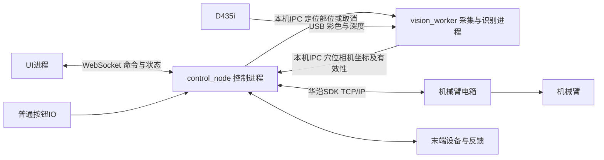

# 希康智能同机上下位机通讯与状态机初版

版本：V0.1 功能验证版 · 更新于2026年10月10日

初版验证流程：选择部位和穴位 → 定位 → 确认时间及能量等参数 → 开始 → 查看状态 → 完成或停止。背部、上肢、下肢使用同一套命令和执行流程。

分开开发前先读[三进程开发交接入口](三进程开发交接入口.md)，其中包含各任务职责、代码边界和可复制的任务说明。

## 1 进程划分与信息流

### 是否采用ROS 2

控制主程序建议采用ROS 2 Humble，运行在Ubuntu 22.04环境中。UI和视觉程序不强制改为ROS 2节点；它们通过本机进程间通讯接入控制主程序。现有UI的5个命令和无ID报文保持不变。

### 相机和穴位识别是否需要拆开

**初版不拆开。相机采集和穴位识别放在同一个视觉进程中，沿用现有zhenjiu程序。**

本地[视觉程序说明](../zhenjiu/README.md)指定入口为[acupoint_locator_refactored.py](../zhenjiu/acupoint_locator_refactored.py)。该文件的RealSenseCapture直接用pyrealsense2采集并对齐彩色/深度，main_live在同一进程中完成MediaPipe姿态推理、比例规则穴位计算、平滑和相机三维坐标提取。当前不是已经接入ROS 2的视觉节点，也不是穴位专用YOLO模型直接输出结果。

在此基础上再拆出独立相机驱动，会额外引入图像传输和同步工作；初版可直接复用已有采集与处理流程。选择这一方案时，不要同时启动另一个RealSense驱动或演示程序占用同一台D435i。

### 需要多少个进程

**完整初版共3个业务进程：UI、控制主程序、相机与穴位识别。后两个属于下位机。** 先用模拟/工装点跑通主流程时只需UI和控制两个进程。启动管理程序、库内部线程和ROS后台工具不计入这3个业务进程。

| 进程 | 建议程序名 | 做什么 |
|---|---|---|
| 上位机UI | hmi_app | 编辑部位、穴位、时间和能量，发送5个命令，显示状态并定期巡查 |
| 下位机控制主程序 | control_node | 唯一状态机、接收方案、请求定位、坐标转换/路径处理、计时、华沿SDK调用、按钮IO、末端控制、状态上报 |
| 下位机相机与识别程序 | vision_worker | 独占D435i，采集彩色和深度、模型推理、穴位计算、提取相机三维坐标，接收定位请求并返回结果 |

vision_worker是对现有脚本接入控制系统后的建议名称，不表示现有脚本已经具备后台通讯接口。初版不单独增加camera_node、SDK进程、通讯网关进程或专门接收穴位信息的进程。

### 信息流



UI只连接control_node，发送“做哪些穴位、什么顺序、多久、什么参数”。vision_worker只向control_node提供当前人体穴位的定位数据，不直接控制机器人。控制主程序汇总两者，再决定是否可以执行。

UI业务接口仍为`ws://127.0.0.1:8765`，仅监听本机，只接受一个UI控制连接，一条文本消息对应一个JSON对象。视觉侧增加独立的本机通讯通道，建议也采用WebSocket，由control_node内的通讯模块接入，不新增桥接进程。视觉内部接口已补充为[控制与视觉进程接口V0.1](希康智能_控制与视觉进程接口_V0.1.md)：8766/vision由control_node提供服务，vision_worker连接，使用LOCATE、CANCEL、LOCATE_RESULT和VISION_STATUS；不改变UI的5个命令。

### 一次定位到执行的顺序

1. UI选择部位并发送SCAN；control_node先检查机械臂已在合适观察位停稳，再清除旧方案和定位，进入SCANNING。
2. control_node向vision_worker提出本部位定位请求。视觉程序读取本次新鲜的彩色/对齐深度，推理并生成穴位名称、侧别和相机三维坐标。
3. 视觉程序返回结果与有效性；接入时补充采集时间、坐标系说明及失败原因。采用末端随动安装，控制主程序使用手眼标定结果与采集时刻的实际法兰位姿转换坐标，详见第13节。
4. control_node检查定位并向UI报告可用穴位。UI选择顺序和参数，发送SET_PLAN；通过后进入READY。
5. UI发START；control_node执行接近、停留、抬离、过渡，每200ms向UI上报状态。
6. UI或普通停止按钮触发STOP；control_node立即取消未执行动作并请求停止，不等待视觉推理结束。扫描中的取消使尚未完成的视觉结果作废，即使结果迟到也不能恢复旧任务。

### 对现有视觉代码需要补什么

现有脚本已将采集和推理放在一起，但主要通过窗口显示和快照JSON提供结果，尚没有本协议中的定位请求、取消和结果回传接口。接入时保留采集/识别逻辑，增加后台通讯及结果交付，使用无独立显示窗口模式。

现有camera_point_mm是相机坐标，不是机械臂基座坐标；coordinate_valid表示取得了深度坐标，不等于穴位识别准确或路线可执行。现有输出未完成表面法向、机器人坐标转换、路径及接近方向校验，这些能力需要补齐后再作实际运动依据。

当前采集和推理是串行循环，RealSense取帧可能等待至5秒。视觉通讯/取消处理不能也阻塞在该循环中；建议采用独立通讯线程和工作线程，在同一进程内运行。若进一步将采集和推理解耦，应使用有界最新帧缓存，确保彩色、深度和时间戳来自同一帧组，避免越积越旧。上述是线程安排，不增加业务进程。

本地视觉程序使用独立Python 3.12虚拟环境。初版可保留该环境，通过本机IPC与ROS 2控制进程交换结果，无需把rclpy强行装入现有环境。以后如统一封装为ROS 2节点，再确认运行时及模型依赖兼容性。

### 周期与后续拆分条件

| 信息流/工作 | 触发或建议周期 |
|---|---|
| UI查询control_node | GET_STATUS每1秒 |
| control_node上报UI | STATUS每200ms；状态变化立即上报 |
| control_node读取设备状态 | 建议每100ms，实机验证后确定 |
| vision_worker相机采集 | 沿用当前640×480、30fps配置；推理实际频率需测量，不能等同30fps |
| 定位结果交付 | 收到本次SCAN请求后返回新鲜有效结果，不把历史快照当本次结果 |

视觉程序持续运行或持续推理不等于已实现可靠的人体运动跟踪；定位失效判定仍需单独实现。视觉进程异常只使定位不可用，由control_node拒绝启动或按运行依赖进入保护处理，不让视觉进程持有机器人控制权。

只有后续多个算法需要共享图像、必须独立重启算法并保持相机采集，或已有多个模块依赖ROS相机话题时，才考虑拆成camera_node与vision_node。当前以验证主要功能为目标，采用3进程即可。

### 与当前工程的关系

已有[commissioning启动文件](../src/massage_hardware/launch/commissioning.launch.py)采用独立ROS相机驱动加只读界面。这是另一条现有接入路径，不能与直接打开D435i的vision_worker同时使用同一设备。本文已改为优先复用zhenjiu合并视觉程序；尚未修改启动脚本或接通实际通讯。

后续用统一启动脚本拉起3个业务进程即可，操作员不需要手动打开3个终端。control_node中耗时SDK调用同样放工作线程，但线程不能保证打断已阻塞的SDK请求，停止时延仍需验收，硬件急停保持独立。

## 2 上位机要做什么

上位机负责让操作员选部位、选穴位、调整顺序，填写总时间、能量、停留方式和过渡方式。先在界面里编辑，点击“确认参数”时一次发送完整方案。开始按钮只在下位机确认方案成功、UI没有未提交修改且状态为`READY`时可用。

上位机负责显示下位机给出的设备连接、当前部位、当前穴位、执行阶段、剩余时间、实际能量反馈及异常。时间由下位机计算，UI不独立倒计时决定工作结束。运行中不能修改方案，也不直接调用机械臂SDK。

**上位机需要定期巡查，但巡查对象是下位机的状态和通讯是否正常。** 初版每1秒发送一次`GET_STATUS`，兼作UI存活通知；另外每200ms检查距上次收到有效`STATUS`的时间。超过1秒未收到状态，界面显示“状态已过期”，禁用开始、扫描和确认参数。连接仍可用时保留停止按钮，但不能把“停止请求已发送”显示成“机械臂已停止”。

每次收到状态，上位机检查故障、连接和测量有效性，据此更新提示和按钮。不需要再直接轮询相机、机器人或传感器。初始连接和重新连接都先读取状态，不自动重发开始或上次方案；连接中断后，活动任务需由下位机停止处理。

## 3 下位机要做什么

下位机负责连接电箱、相机和IO，读取机械臂及末端反馈，完成定位，把穴位转换成当前目标位姿，检查方案并执行。UI只给出“做什么”，下位机负责“怎么移动、什么时候计时、什么时候停止”。

下位机只保存一份当前方案。在IDLE/READY接受`SET_PLAN`时，清除旧的可执行方案，再校验新方案；通过后进入`READY`，失败则回`IDLE`并说明原因。其他状态拒绝该请求，不改变正在执行的方案。收到`START`后立即进入`RUNNING`，再按穴位顺序接近、停留、抬离和过渡；只在有效停留阶段扣减时间。完成或停止后清除待执行方案，下一次开始前必须重新确认参数。

**下位机既要定期检查设备，也要定期主动上报。** 初版建议每100ms读取/更新机器人及必要传感器状态，每200ms向UI上报一次完整状态；发生开始、停止、完成或故障时立即额外上报。收到`GET_STATUS`时也立即发送当前完整状态，不必等待下一次定时上报。

设备检查包括连接、急停/故障、运动及到位反馈，以及当前服务所需的温度、力或距离是否有效。设备数据有独立的新鲜度检查：上报程序还能运行，不代表设备数据就是新的；采集超时后应将相关值标为无效，并按配置停止或报错。100ms是初版普通状态采集建议，不是力控或温控实时闭环周期，实际采集周期及失效阈值需按设备能力确认。

下位机记录最后一次收到UI合法请求的本机单调时间。连续3秒未收到请求，或UI连接已关闭，活动任务立即进入停止处理；空闲时只清除待执行方案。停止处理不等待UI确认。相机计算、文件操作和SDK阻塞不能占住通讯与停止处理线程。

上述1秒、200ms、3秒是软件联调初值。硬件急停仍直接走厂家安全回路；同一台电脑死机时不能依靠这两个进程互相保护。

## 4 背部 上肢 下肢穴位如何通用

三种部位复用相同的数据结构：**部位 + 穴位名称 + 侧别**。部位用`BACK`、`UPPER_LIMB`、`LOWER_LIMB`，侧别用`LEFT`、`RIGHT`、`MIDLINE`。左右始终按被服务者自身左右定义，不按屏幕左右定义；不在中线的穴位必须填写左或右。

上位机从同一份约定的穴位配置中显示名称和允许侧别，下位机用同一配置校验。初版配置可随两个程序一起发布，无需另做穴位编号或穴位管理接口。穴位数组的顺序就是执行顺序，不再限制为固定的P1、P2、P3。实际可选名称与部位归属由项目穴位库确定。

下位机根据所选部位和当前姿态获取实际坐标：调试时可以使用工装上的示教位置，接人体定位时使用当前人的扫描结果。**通用穴位定义仍需结合当前人体定位，不能把上一人的机械臂坐标用于下一人。** UI的示意图只用于选点与显示，不把图上的像素位置直接发送给机械臂。

一份方案先处理一个部位、一个已定位姿态。上肢和下肢有不同的朝向、表面法向及避障要求，统一命令后仍由下位机分别规划。切换部位、人体/肢体移动或更换工具后，需要重新定位和确认方案，不自动从背部跨到上肢或下肢。此限制用于简化初版，不影响三种部位复用接口。

`SCAN`携带部位；开始扫描就清除旧方案和旧定位。成功后状态上报当前部位、定位是否有效以及本次可用的“穴位名称 + 侧别”列表。扫描本身不启动工作。未接视觉时返回“视觉定位未接入”，不能伪报扫描成功；下位机可通过独立的模拟/工装测试配置验证同一执行流程。

## 5 命令和回复如何处理

命令只有5个：`GET_STATUS`获取状态，`SCAN`进行所选部位定位，`SET_PLAN`确认完整方案，`START`开始当前方案，`STOP`取消扫描或停止工作。普通硬件停止按钮调用同一个停止函数，不依赖UI。

除了`GET_STATUS`以外，命令收到后都回复`REPLY`，回显命令名称及成功/失败说明。合法`GET_STATUS`直接返回`STATUS`；格式非法则与其他非法请求一样返回失败REPLY。`SET_PLAN`成功回复返回实际保存的参数，UI据此显示“已确认”；`START`和`STOP`回复成功只表示受理，动作结果看之后的`STATUS`。扫描结果也通过`STATUS`中的定位字段上报。

不使用ID后，初版采用简单顺序规则：同一时刻只允许一个普通控制请求等待回复；按钮发出后先锁住，收到回复再开放。状态查询照常发送。**STOP始终可以打断等待，不放在普通请求后面排队。** 下位机先处理STOP、使未开始的动作失效；尚未完成的扫描或方案检查结果不得在停止后重新推进状态。

不自动重试`START`、`SCAN`或`SET_PLAN`。超时先查询状态；结果仍无法确认时执行STOP，并在确认停止或现场处理后重新提交。断开重连时丢弃客户端未发送请求和旧连接回复，下位机不保留跨连接的待执行方案。`READY`以外拒绝START，受理START时立即离开READY，因此连续点击不会排成多个任务；结束后回IDLE，也不会被迟到的START再次启动。

运行中调参、暂停续作、记录归档和复杂恢复暂不实现。初版只有停止；需要再做时从头确认和执行。正常完成按已验证的路线退出；手动停止优先中止，不承诺自动退至安全位。急停或设备断联时上报ERROR和实际已知状态，不宣称停止或退让已经成功。

## 6 双方职责与周期汇总

| 执行方 | 工作 | 触发方式或建议周期 |
|---|---|---|
| 上位机 | 选择部位、穴位、顺序及工作参数 | 操作员编辑，仅保存在UI草稿 |
| 上位机 | 提交方案、开始、停止、扫描 | 点击相应按钮时发送 |
| 上位机 | 查询状态，通知自身仍在线 | 每1秒发送GET_STATUS |
| 上位机 | 检查下位机状态是否过期 | 每200ms检查，连续1秒无STATUS则提示并限制操作 |
| 上位机 | 更新进度、反馈、异常与按钮 | 每次收到STATUS时处理 |
| 下位机 | 采集机器人及必要传感器状态 | 建议每100ms，实际以设备能力为准 |
| 下位机 | 检查故障、反馈失效、动作超时 | 每轮状态更新及异常事件发生时 |
| 下位机 | 主动上报完整状态 | 每200ms；状态变化/故障时立即上报 |
| 下位机 | 响应状态查询 | 收到GET_STATUS立即返回STATUS |
| 下位机 | 检查UI存活 | 连接关闭立即处理；连续3秒无合法请求触发停止 |
| 下位机 | 定位、规划、执行、计时及停止 | 收到命令后由状态机驱动 |

## 7 命令汇总

| 界面操作 | 命令 | data内容 | 接收后处理 | 返回 |
|---|---|---|---|---|
| 打开页面/定期巡查 | GET_STATUS | 空对象 | 读取当前完整状态 | STATUS |
| 选择部位后点击扫描 | SCAN | region | 清除旧方案，扫描该部位 | REPLY；随后STATUS给出定位结果 |
| 确认参数 | SET_PLAN | region、points、total_time_s、energy、gap_mm、dwell_mode、transition_mode | 校验并保存唯一当前方案 | REPLY；成功进入READY |
| 开始工作 | START | 空对象 | 检查当前方案及设备，执行路线 | REPLY；随后STATUS显示实际进展 |
| 停止/取消扫描 | STOP | 空对象 | 取消后续任务，处置可控输出并请求停止 | REPLY；随后STATUS确认结果 |

## 8 方案参数汇总

| 参数 | 含义 | 初版约定 |
|---|---|---|
| region | 人体部位 | BACK背部、UPPER_LIMB上肢、LOWER_LIMB下肢 |
| points | 穴位列表 | 每项含name名称、side侧别；按数组顺序执行 |
| total_time_s | 总有效工作时间，秒 | 正整数；按点数平均分配，暂要求能整除 |
| energy.type | 能量控制类型 | TEMPERATURE温度或FORCE力，二者选一 |
| energy.value / unit | 目标数值与单位 | 温度用C，力用N；不使用含义不明的强度数字 |
| gap_mm | 工作间隙，毫米 | 艾灸方案必填；按摩省略，不能用间隙代替力控制 |
| dwell_mode | 穴位停留方式 | 初版仅STATIC定点停留 |
| transition_mode | 穴位过渡方式 | 初版仅LIFT_MOVE_APPROACH抬起、移动、接近 |

抬离距离、速度、加速度、工具姿态和允许参数范围固定在下位机配置中，先不开放UI调节。整段路径由下位机检查，不只检查目标点。温度目标与力目标代表两种不同末端能力，实际接入哪种先验证哪种；未配置相应能力时拒绝实机方案。

## 9 下位机状态汇总

下位机只用一个主状态，执行中再用step说明当前动作阶段。

| 状态 | 含义 | 如何进入下一状态 |
|---|---|---|
| IDLE | 空闲，没有可执行方案 | SCAN进入SCANNING；SET_PLAN成功进入READY |
| SCANNING | 正在定位 | 成功/定位失败回IDLE；STOP进入STOPPING |
| READY | 方案已确认，可开始 | START进入RUNNING；SCAN清除方案并扫描 |
| RUNNING | 正在工作 | 正常完成或STOP进入STOPPING；故障进入ERROR |
| STOPPING | 正在取消任务、停止或正常退出 | 反馈确认后清除方案并回IDLE；失败/超时进入ERROR |
| ERROR | 故障或执行结果不明 | 现场处理后重新初始化，回IDLE；不自动恢复 |

GET_STATUS和STOP在所有状态可处理；STOP在IDLE/READY清除待执行方案并保持/回到IDLE，在ERROR不清故障。SET_PLAN只允许IDLE/READY，校验失败清除旧方案并回IDLE。SCAN只允许IDLE/READY。急停或关键设备故障在任何状态都进入ERROR。

```text
IDLE → 确认参数 → READY → 开始 → RUNNING → STOPPING → IDLE
                              ↓故障            ↓失败
                            ERROR ←────────────┘

RUNNING内部：接近 → 定点停留计时 → 抬离 → 过渡到下一点 → 接近……
```

只有DWELL且工作反馈有效时扣减时间。接近、过渡、退出不扣时间。停止时冻结计时并清除后续动作，不能用阻塞的长时间sleep完成停留。取消后的旧任务回调必须丢弃，不能让扫描或到位回调把已经停止的任务继续执行。

## 10 报文示例

本节保留速查示例；[完整报文附录](希康智能_初版完整报文示例.md)给出5个命令及各执行/故障场景的全部字段，包含背部、上肢、下肢的温度与力方案、完整成功回复以及失败回复。可直接读取[独立JSON场景索引](通讯协议示例/完整场景/场景索引.json)。

以下为模拟格式示例。穴位名称沿用原界面示例，温度、距离和时长仅用于联调说明，不是实机治疗参数。其他部位沿用同一结构，替换region及本部位的穴位列表即可。

### 确认方案

```json
{
  "cmd": "SET_PLAN",
  "data": {
    "region": "BACK",
    "points": [
      {"name": "大椎", "side": "MIDLINE"},
      {"name": "肩井", "side": "LEFT"},
      {"name": "肩井", "side": "RIGHT"}
    ],
    "total_time_s": 60,
    "energy": {"type": "TEMPERATURE", "value": 47, "unit": "C"},
    "gap_mm": 30,
    "dwell_mode": "STATIC",
    "transition_mode": "LIFT_MOVE_APPROACH"
  }
}
```

下位机校验成功的REPLY应在data内回显完整已保存方案，并增加`time_per_point_s: 20`。失败示例如下：

```json
{
  "type": "REPLY",
  "cmd": "SET_PLAN",
  "ok": false,
  "message": "当前部位尚未完成定位",
  "data": {}
}
```

### 查询 扫描 开始 停止

每行是一条独立消息，分别发送，不把多条JSON拼成一条WebSocket消息。

```json
{"cmd": "GET_STATUS", "data": {}}
```

```json
{"cmd": "SCAN", "data": {"region": "UPPER_LIMB"}}
```

```json
{"cmd": "START", "data": {}}
```

```json
{"cmd": "STOP", "data": {}}
```

### 定期状态上报

```json
{
  "type": "STATUS",
  "data": {
    "mode": "SIMULATION",
    "robot_connected": true,
    "robot_feedback_valid": true,
    "state": "RUNNING",
    "step": "DWELL",
    "region": "BACK",
    "positioning_valid": true,
    "available_points": [
      {"name": "大椎", "side": "MIDLINE"},
      {"name": "肩井", "side": "LEFT"},
      {"name": "肩井", "side": "RIGHT"}
    ],
    "current_point": {"name": "肩井", "side": "LEFT"},
    "remaining_time_s": 35,
    "actual_energy": {"type": "TEMPERATURE", "value": 46.8, "unit": "C", "valid": true},
    "actual_gap_mm": 30.2,
    "gap_valid": true,
    "result": "NONE",
    "error": ""
  }
}
```

## 11 上报字段汇总

| 字段 | UI如何使用 |
|---|---|
| mode | 显示SIMULATION模拟或REAL实机；由下位机配置决定 |
| robot_connected / robot_feedback_valid | 区分连接是否存在与设备反馈是否有效，不能只看通讯连上了 |
| state / step | 显示主状态与动作阶段；step取APPROACH、DWELL、RETRACT、TRANSFER，无动作时为NONE |
| region / positioning_valid | 当前定位部位及是否有效；未定位region可为null |
| available_points | 本次定位可用的名称与侧别，供UI选择；无有效定位时为空数组 |
| current_point | 当前穴位名称、侧别；没有当前点时为null |
| remaining_time_s | 下位机计算的剩余有效秒数，没有方案时为0；ERROR时可保留故障前剩余值供说明 |
| actual_energy / actual_gap_mm / gap_valid | 实际温度或力、实际间隙及有效性；无数据用null和false，不能填目标值冒充反馈 |
| result | NONE未结束、COMPLETED正常完成、STOPPED主动停止、FAILED故障 |
| error | 异常或定位失败说明；正常时为空字符串 |

未选能量类型时actual_energy的type、value、unit均为null且valid=false。跨点TRANSFER的current_point表示下一目标穴位。已停止且回IDLE时清除当前点和剩余时间。

格式错误且无法识别cmd时，返回REPLY并令cmd为null；可识别则回显命令。初版拒绝未定义字段、重复名称侧别及非法参数。具体失败报文见完整附录。

结束结果保留到下次提交方案。模式为模拟时，设备与测量值只代表模拟器，不代表实机。状态定期到达但robot_feedback_valid为false时，上位机仍要按设备异常处理。

## 12 SDK对应与初版验收

| 下位机动作 | 华沿SDK接口 |
|---|---|
| 连接电箱 | HRIF_Connect |
| 读取运动、故障、急停等状态 | HRIF_ReadRobotState |
| 读取实际位姿 | HRIF_ReadActPos |
| 执行已规划的接近、抬离段 | HRIF_MoveL |
| 请求停止 | HRIF_GrpStop |

SDK返回成功不代表已经到位或已经停止，必须结合发送后的新鲜反馈确认。艾灸温控另依赖末端接口；手动点燃的艾条不能假定由机械臂停止而熄灭。初版不上UI使能/故障复位按钮，由现场调试准备。

具体步骤、软件时限、证据格式及实机能力门槛见[初版验收标准](希康智能_初版通讯与主功能验收标准.md)。每条用例需填写实测结果，不能将示例JSON或SDK返回成功视为验收通过。

资料依据：[服务流程界面PDF](希康智能_服务流程界面_图片版.pdf)、[本地华沿SDK](../SDK/HUAYAN/python%20API接口/HuayanRobotPythonSDK_V1.1.1.1/CPS.py)。配套[JSON示例](通讯协议示例/README.md)同步采用无编号格式。本文为通讯和软件职责设计，尚未实现或完成实机联调。

## 13 机械臂随动相机安装与坐标系

本阶段采用3个业务进程：UI、控制主程序、相机与识别程序。相机按用户选定方案安装在机械臂上，采用随动相机方式，不再以床上固定相机作为初版布局。

### 安装在末端法兰侧面的刚性支架上

用户参考照片中“腕部附近、工具上方侧挂”的位置可作为候选，实际应先确认其固定在法兰输出侧还是前级连杆。照片不能确认模块类型及关节连接。准备物品、采集步骤和验证方法见[随动相机安装与手眼标定操作清单](希康智能_随动相机安装与手眼标定操作清单.md)。

建议D435i安装在机械臂末端法兰侧面的刚性支架上，与工具保持固定关系，随末端一起运动。支架应明确连接在第六轴输出法兰/工具安装板上，而不是笼统固定在某段腕部外壳：若相机和法兰之间还隔着活动关节，就不能使用一个固定的法兰到相机变换。

安装位置向工具侧面留出空间，让扫描时镜头能看到人体，避免工具遮挡彩色镜头及深度模块；同时考虑相机、支架、USB线与人体、床和机械臂自身的碰撞。线缆需固定和留出关节活动余量，不能在运动中拉动相机支架。相机及支架也纳入工具负载、重心和碰撞外形配置，具体尺寸和承载参数待机械设计确认。

如果实际决定安装在前臂或第五轴连杆，仍可使用，但坐标链应改为该连杆的实时位姿和该连杆到相机的固定外参，不能继续使用法兰链。本节默认相机刚性固定在末端法兰侧。

### 初版先停稳扫描 再执行

初版采用“到观察位 → 停稳 → 扫描定位 → 确认方案 → 执行”的工作方式，不做机械臂运动中的在线识别闭环，也不要求工具接近人体后相机一直能看见穴位。

当前zhenjiu算法依赖肩、髋和相关四肢关键点。相机移到机械臂上之后仍要在观察位获得足够完整的画面，不能只拍一小块皮肤就假定现有模型能定位。背部、上肢、下肢可以分别准备合适的观察姿态，但每个姿态都需要验证机器人可达性、整段移动路径、关键点可见范围和深度质量。

初版观察位先通过现场调试工具准备，**SCAN只在观察位停稳后采集，不自动驱动机械臂去观察位**。这样保留现有5个命令且不改变“扫描不会自动运动”的验证边界。机器人未停稳、当前姿态不满足观察条件或没有有效采集位姿时，拒绝SCAN并提示先完成观察位准备。以后若将返回观察位纳入自动流程，需明确运动入口并补充对应状态和验收，不能悄悄附加在SCAN中。

采集时保持机器人不动，确认采集前后的实际位姿稳定，并使用停稳后获取的新鲜图像和反馈。停止采集请求后到达的迟到图像/结果不能激活旧定位。机器人停稳只简化时间配对，不能用很早的缓存位姿代替本次采集位姿。

扫描完成后把穴位转换到基座坐标系再保存。机器人随后移动不会改变一个静止人体穴位的基座坐标；但人体或肢体移动后结果必须失效并重扫。随动相机不天然提供持续人体跟踪能力。

### 世界坐标系仍与机械臂基座重合

相机随机械臂运动，但世界坐标系保持固定。初版单臂、底座水平固定时，定义world与厂家robot_base重合，沿用厂家原点和轴方向，不将world放在相机或末端上。侧装/倒装时可另设Z向上的固定world，并标定到厂家基座的变换。

床坐标bed_frame仍可放在床架刚性标记处，仅用于工作区域和床的位置描述。工具工作点tool_tcp单独标定，不能用相机光心代替。

| 坐标系 | 是否随机械臂运动 | 用途 |
|---|---|---|
| world / robot_base | 否，底座固定时不变 | 保存穴位目标及机器人运动参考 |
| flange | 是 | 相机安装参考，取实际法兰位姿 |
| camera_color_optical_frame | 是 | 当前穴位相机三维坐标 |
| tool_tcp | 是 | 工具实际工作点 |
| bed_frame | 随床移动；床固定时不变 | 床和环境的几何关系 |

相机光学坐标为X向图像右、Y向图像下、Z向前，与厂家法兰/基座轴不同。保持ROS内部m/rad，camera_point_mm在入口转成m。坐标约定参考[ROS REP 103](https://github.com/ros-infrastructure/rep/blob/master/rep-0103.rst)。

### 坐标转换增加实时法兰位姿

定义T_A_B表示将B坐标系中的点变换到A坐标系。使用齐次坐标且所有长度单位一致：

```text
T_base_camera(t_capture) = T_base_flange(t_capture) × T_flange_camera
p_base = T_base_flange(t_capture) × T_flange_camera × p_camera
```

- T_base_flange(t_capture)：采集时刻法兰相对基座的实际位姿，随机器人运动变化。
- T_flange_camera：相机相对法兰的固定变换，由手眼标定获得。
- p_camera：视觉给出的穴位相机坐标，使用camera_point_mm换算单位后参与计算。
- p_base：保存并用于后续规划的穴位基座坐标。

不能用之前固定相机方案中的一个常量T_base_camera覆盖所有机械臂姿态。视觉进程负责图像、坐标及采集信息；控制主进程负责实际位姿配对、变换链和结果有效性检查。

厂家SDK返回的“实际位姿”必须核对究竟是法兰还是当前TCP、基于Base还是用户坐标系。若得到的是基座下TCP位姿，并已知工具标定T_flange_tcp，则：

```text
T_base_flange = T_base_tcp × inverse(T_flange_tcp)
```

只有在参考系明确且工具配置一致时才可这样换算。不能将HRIF_ReadActPos或其他接口里任意6个数直接命名为法兰位姿，也不能未经确认将厂家姿态角当成ROS欧拉角。

### 手眼标定和安装验证

这种方式属于eye-in-hand。将标定板固定在工作区，让机械臂在多个具有不同位置和旋转方向的姿态下停稳拍摄，同时记录对应法兰位姿，求解T_flange_camera。只平移或只围绕单一轴转动不能充分约束标定；应覆盖实际观察姿态。标定流程及变换方向参考[OpenCV手眼标定文档](https://docs.opencv.org/4.11.0/d9/d0c/group__calib3d.html)。

验证时使用未参与标定的固定工装点，从不同机器人姿态观察同一点，转换后的p_base应在事先确定的误差范围内保持一致；同时与该点独立测得的基座坐标比较。仅多姿态结果一致仍不足以证明没有共同偏差。

相机支架松动、重新安装或安装关系变化后重做手眼标定。更换工具需更新TCP、负载和碰撞模型；若相机也随换工具被拆装，还需重新验证相机外参。相机、工具、支架和线缆一起检查观察、接近、过渡及退出路径。

### 初版落地顺序

1. 确定法兰侧刚性安装支架及相机朝向，检查视野、遮挡、负载和走线。
2. 准备背部/上肢/下肢适用的观察位，实测现有识别程序能否获得所需关键点和深度。
3. 完成法兰到相机的手眼标定、工具TCP标定及多姿态工装点验证。
4. 将采集时间、实际法兰位姿和camera_point_mm关联起来，转换并保存基座下穴位坐标。
5. 按原有SET_PLAN、START、STOP执行工装测试，验证镜头/支架不会碰撞且取消/故障不会恢复旧任务。

具体支架尺寸、观察距离、机器人可达姿态及允许误差尚需现场确定。本文不直接修改机械臂运动参数或相机配置，仍保留3个进程。
